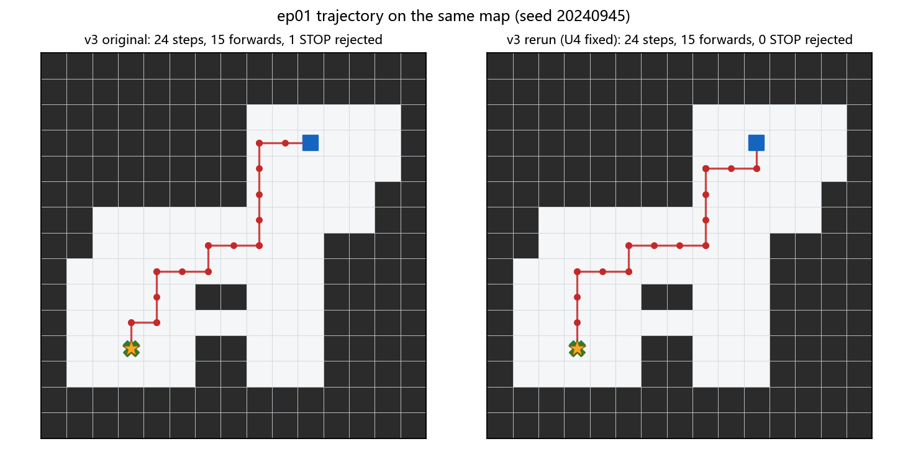

# MapGPT 二维复现与导航决策升级实验

**汇报日期**：2026 年 10 月 20 日
**实验平台**：Ubuntu 22.04 虚拟机（Python 3.10）+ Windows 中转服务（DashScope / qwen-plus）
**代码版本**：`mapgpt_v3.py`（含 2026-10-19 停止门修正）

---

## 摘要

本工作围绕 MapGPT（ACL 2024）"地图引导提示 + 自适应路径规划"的范式，在自建二维网格仿真中完成复现与结构化升级。基线版本（v2）沿用论文风格的提示词结构，仅依赖局部观测与在线拓扑图进行逐步决策；升级版本（v3）在不改动模型权重的前提下，向提示词与决策回路中引入四项机制：锚点排序、未探索路径枚举、三级卡死检测与两级响应、停止自检门。

在 10 幅 15×15 随机室内地图、统一随机种子、统一模型与 60 步预算的条件下，v3 相较 v2 的路径效率 SPL 由 0.8765 提升至 0.9882，卡死步占比由 0.1822 降至 0，总决策步数由 236 降至 147，综合分 DS 由 0.7622 提升至 0.8198；建图精度 AP 由 0.7329 降至 0.6627，为唯一负向指标，其原因已定位为提示词长度增长导致的注意力竞争，并给出了后续验证方案。本周同时定位并修正了停止自检门中"观测符号匹配"与"提示规则表述"不一致的缺陷。

---

## 1 项目背景

视觉—语言导航（Vision-and-Language Navigation, VLN）要求智能体依据自然语言指令，在未知室内环境中逐步决策直至抵达目标。MapGPT 的核心思想是：将智能体在线构建的拓扑地图以语言形式写入提示词，使大语言模型在每一步决策时同时获得"语言目标"与"结构化的空间记忆"，并通过多步规划约束局部动作。

本工作并非对官方 Matterport3D / Habitat 基准的复现，而是在自建二维网格环境中对该范式的**机制验证**。所有数值仅用于版本间的内部对比，不与论文表格对标。

前期工作已经完成两轮基础实验：

| 实验 | 规模 | SR | SPL | AP |
|---|---|---|---|---|
| 主实验 | 20 局，15×15 | 0.9000 | 0.9221（仅成功局口径） | 0.7691 |
| 大地图实验 | 8 局，19×19 | 1.0000 | 0.8839 | 0.7236 |

在此基础上，本轮工作从"能否跑通"转向"决策质量能否被结构性改进"，并采用同一批地图进行基线—升级的受控对比。

---

## 2 任务定义与仿真环境

### 2.1 状态与动作

环境为 15×15 的占据栅格，每格取值为可通行或墙体。智能体状态由位置 $(x_t, y_t)$ 与朝向 $h_t \in \{\text{N},\text{E},\text{S},\text{W}\}$ 构成。

动作空间为四个原子动作：

| 动作 | 语义 | 是否改变位置 |
|---|---|---|
| `FORWARD` | 沿当前朝向前进一格 | 是（前方为墙则撞墙，位置不变） |
| `LEFT` | 逆时针旋转 90° | 否 |
| `RIGHT` | 顺时针旋转 90° | 否 |
| `STOP` | 终止本局 | 否 |

**每一步对应一次模型决策，而非一段位移。** 转向同样消耗步数预算；`STOP` 消耗一步并结束回合。单局预算为 60 步。

### 2.2 局部观测

智能体不具备全局地图，仅获得以自身为中心、半径 $r=2$ 的局部窗口（5×5）。可见性由八邻接广度优先搜索确定，墙体阻断视线；窗口外统一记为未知。观测以符号矩阵与自然语言并列呈现：

```
egocentric_local_view radius=2 heading=SOUTH robot_cell=(4,10) glyph=v
symbols: R=robot  .=free  #=wall/obstacle  G=goal_if_visible  ?=out_of_view
.....
....#
..R..
.G..#
....#
front: FREE cell=(4,11)
right: FREE cell=(3,10)
back:  FREE cell=(4,9)
left:  FREE cell=(5,10)
forward_blocked=False
```

提示词同时包含已探索区域的局部草图、拓扑连通句（`Place i is connected with Places j, k.`）与历史动作序列，共同构成"语言化地图记忆"。

### 2.3 地图生成

每幅地图在 $15\times15$ 画布上随机布置 3–5 个矩形房间（边长 3–6），以 L 型走廊依次连通，并保证起点与终点可达、最短路长度不小于 5。随机种子固定为

$$s_i = 20240928 + 17i,\qquad i=0,\dots,9.$$

本轮 10 幅地图的可通行格数量为 47–97 个（均值 69.2），最短路径长度 8–17 格。可通行格占比偏低的原因在于：房间以矩形切挖方式生成，房间之间、房间与边界之间存在大量未开凿区域，墙体占比自然较高；这是"室内多房间"布局的合理结果，而非生成失败。

### 2.4 与原论文的差异

| 维度 | 原论文（R2R / Matterport3D） | 本实验 |
|---|---|---|
| 场景 | 90 栋真实住宅的三维重建，约 10,800 个全景视点 | 随机生成的 15×15 二维网格 |
| 单步粒度 | 移动到相邻可导航视点，通常跨越数米 | 前进一格（转向亦计一步） |
| 指令 | 以地标与转向关系描述路径 | 给出方位、房间数与终点坐标 |
| 感知 | RGB / 全景图像 | 符号化局部窗口 |

Matterport3D 的单栋场景平均包含约 120 个视点，其可导航规模与本实验的 69 个可通行格在数量级上接近，但**动作粒度与感知模态完全不同**：论文的一步对应空间中的一段位移，本实验的一步对应一个格子，因此两者的步数、SPL 均不可直接比较。

需要特别说明：本实验在指令中直接给出了终点坐标，这使任务退化为"已知自身与目标坐标、障碍未知"的点对点导航，难度低于纯语言指令的 R2R 设定。该放宽条件在前期工作中已存在，本轮为保持可比性未作改动，但应在结论中被明确限定。

---

## 3 方法

### 3.1 基线 v2

基线严格采用 MapGPT 风格的提示结构，包含任务描述、语言指令、历史 $H_t$、局部观测 $O_t$、已探索区域、拓扑连通图、上一步规划 $P_{t-1}$ 与动作空间，要求模型依次输出 `<THINK>`、`<MAP>`、`<PLAN>`、`<ACTION>` 四个标签。模型每步独立调用，无跨步记忆，历史信息全部由提示词承载。

### 3.2 升级 v3

四项机制均在提示词层面或决策回路层面实现，**不训练、不微调模型**。

| 编号 | 机制 | 解决的问题 | 实现要点 |
|---|---|---|---|
| U1 | 锚点排序 | 路口处缺乏明确的下一跳目标 | 在已观测图上计算 $d_{\text{known}}$，与曼哈顿距离相加后取前 3 名；附加自然语言方位 |
| U2 | 未探索路径枚举 | 重复探索、遗漏方向 | 输出 frontier 总数、四方向未探索计数、确认死胡同与重复访问格，并写入硬规则 R1–R6 |
| U3 | 卡死检测与响应 | 局部震荡、原地打转 | 三级检测器；一级提示、二级程序接管 |
| U4 | 停止自检门 | 未抵达即输出 STOP | 坐标校验；未通过则同一步驳回并重新询问 |

**U1 锚点排序。** 设 frontier 集合为 $\mathcal{F}_t$，锚点得分定义为

$$\mathrm{score}(f)=d_{\text{known}}(q_t,f)+\lVert f-g\rVert_1,\qquad f\in\mathcal{F}_t,$$

按得分升序取前三名作为 `ANCHOR_1..3`。其中 $d_{\text{known}}$ 为在**已观测可走格**上做四连通广度优先搜索所得的步数，$\lVert\cdot\rVert_1$ 为曼哈顿距离。两项等权相加，本质上是 A\* 算法中 $f=g+h$ 的启发式估计；由于未知墙体不在已知图中，$d_{\text{known}}$ 可能低估真实代价，因此仅作为排序依据而非精确规划。

**U2 未探索路径枚举。** 每步向提示词注入 frontier 清单、四方向的未探索计数、死胡同清单与重复访问清单，并附加六条硬规则，例如"首选锚点不可达时立即切换次优锚点""上一步未带来新格则不得重复同一动作""存在 frontier 时不得停止"。

**U3 卡死检测。** 记 $q_t$ 为第 $t$ 步位置，$n(q)$ 为格子 $q$ 的累计访问次数，$h(q)$ 为到终点的曼哈顿距离。

$$
\begin{aligned}
D_1 &: (q_{t-3},q_{t-2},q_{t-1},q_t)=(A,B,A,B),\ A\neq B,\\
D_2 &: n(q_t)\ge 3,\\
D_3 &: \min_{k=t-5,\dots,t} h(q_k)\ \ge\ h(q_{t-6}).
\end{aligned}
$$

任一条件成立即记该步为卡死步。响应分两级：一级将检测器名称与提示写入提示词，决策权仍归模型；二级在连续 3 步卡死且未踏入新格时，由程序在四个相邻可走格中选择"访问次数最少、其次离终点最近"的一格执行，单局上限 5 次。

**U4 停止自检门。** 模型输出 `STOP` 时，仅当当前位置与终点坐标一致才予放行，否则驳回并在同一步内携带驳回理由重新询问，单局最多驳回 3 次。

---

## 4 评价指标与公式

### 4.1 符号约定

| 符号 | 含义 |
|---|---|
| $N$ | 局数 |
| $T_i$ | 第 $i$ 局总步数（含转向与停止） |
| $S_i$ | 第 $i$ 局成功指示变量，抵达终点为 1，否则为 0 |
| $l_i$ | 第 $i$ 局最短路径长度（格边数，四连通 BFS） |
| $p_i$ | 第 $i$ 局成功前进次数（撞墙与转向不计） |
| $d_t$ | 第 $t$ 步结束后位置到终点的真值 BFS 步数 |
| $AP_{i,t}$ | 第 $i$ 局第 $t$ 步的建图精度 |

### 4.2 局级指标

**成功率**

$$SR=\frac{1}{N}\sum_{i=1}^{N}S_i.$$

**标准路径长度加权成功率（主指标）**

$$SPL=\frac{1}{N}\sum_{i=1}^{N}S_i\cdot\frac{l_i}{\max(p_i,l_i)}.$$

失败局贡献 0。分母取实际前进次数与最短长度的较大者，保证比值不超过 1；绕行越多，$p_i$ 越大，得分越低。

**仅成功局口径**

$$SPL_{\text{succ}}=\frac{1}{|\{i:S_i=1\}|}\sum_{i:S_i=1}\frac{l_i}{\max(p_i,l_i)}.$$

该口径与标准口径的差异在于是否对失败局计零。前期汇报中的 0.9221 属于此口径，换算为标准口径为 0.8299。

**Oracle 成功率**

$$OSR=\frac{1}{N}\sum_{i=1}^{N}\mathbb{1}\left[g\in\tau_i\right],$$

其中 $\tau_i$ 为第 $i$ 局轨迹，$g$ 为终点。该指标只要求"曾经到达"，不要求终止于终点。

**导航误差**

$$NE=\frac{1}{N}\sum_{i=1}^{N}d_{\text{BFS}}\left(q_i^{\text{end}},g\right),$$

不可达时以曼哈顿距离替代。

**建图精度**

$$AP_{i,t}=\frac{1}{2}\left(\text{cell\_acc}_{i,t}+\text{edge\_J}_{i,t}\right),\qquad
AP=\frac{1}{N}\sum_{i=1}^{N}\frac{1}{T_i}\sum_{t=1}^{T_i}AP_{i,t}.$$

其中

$$\text{cell\_acc}=\frac{\#\{\text{预测且越界内的格子中标签正确者}\}}{\#\{\text{模型本步预测的格子}\}},\qquad
\text{edge\_J}=\frac{|E_{\text{pred}}\cap E_{\text{obs}}|}{|E_{\text{pred}}\cup E_{\text{obs}}|}.$$

两项任一缺失时取可用项的均值；均缺失记 0。需要指出，`cell_acc` 的分母为模型自行报告的格子数，若模型只报告少量确定格子即可获得较高精度，该指标存在被策略性利用的空间。

**路径效率比**

$$ER=\frac{1}{N}\sum_{i=1}^{N}\frac{l_i}{\max(p_i,l_i)}.$$

与 SPL 同式但不乘 $S_i$，用于单独观察路径的几何效率。

**探索覆盖率**

$$COV=\frac{1}{N}\sum_{i=1}^{N}\frac{|O_i^{\text{free}}|}{|F|},$$

$O_i^{\text{free}}$ 为已观测可走格，$F$ 为全图可走格。

**卡死率**

$$STK=\frac{\sum_{i}\sum_{t}\mathbb{1}[s_{i,t}]}{\sum_{i}T_i},$$

$s_{i,t}$ 表示第 $i$ 局第 $t$ 步是否触发任一检测器。注意其为全局汇总比例，长局权重更大。

**强制逃逸次数**

$$GRD=\sum_{i}\sum_{t}\mathbb{1}[\text{guard}_{i,t}],$$

基线无此机制，恒为 0。

### 4.3 步级综合分

每一步计算五个位于 $[0,1]$ 的分项，加权求和：

$$DS_t=0.30P_t+0.20V_t+0.25M_t+0.15C_t+0.10G_t,$$

$$DS=\frac{1}{N}\sum_{i=1}^{N}\frac{1}{T_i}\sum_{t=1}^{T_i}DS_{i,t}.$$

**进度项**

$$P_t=\mathrm{clip}\left(\frac{d_{t-1}-d_t+1}{2},0,1\right),$$

即靠近一步记 1、距离不变记 0.5、远离一步记 0；本步导致回合结束时，终止于终点记 1，否则记 0。

**新颖项**

$$
V_t=\begin{cases}
1.00, & \text{首次踏入新格}\\
0.50, & \text{踏入已访问格}\\
0.25, & \text{原地转向且未撞墙}\\
0.00, & \text{撞墙}
\end{cases}
$$

**建图项**

$$M_t=AP_{i,t}.$$

**干净项**

$$
C_t=\begin{cases}
1.00, & \text{无卡死告警且无接管}\\
0.50, & \text{有告警但由模型自行决策}\\
0.00, & \text{本步被 guard 接管}
\end{cases}
$$

**承诺项**

$$
G_t=\begin{cases}
1.00, & \text{子目标与上一步相同，或上一步子目标已到达}\\
0.75, & \text{上一步子目标已失效}\\
0.00, & \text{无理由更换子目标}\\
0.50, & \text{未解析出 \texttt{<SUBGOAL>}}
\end{cases}
$$

权重为人工设定，未经过数据拟合；其作用是对内诊断，对外结论仍以 SR 与 SPL 为准。

---

## 5 实验设置

| 项目 | 设置 |
|---|---|
| 地图 | 10 幅，15×15，种子 $20240928+17i$ |
| 基线 | v2，原始提示词，日志按统一公式重算 |
| 升级 | v3，U1–U4 全开 |
| 模型 | qwen-plus，单步调用，温度取默认值 |
| 步数上限 | 60 |
| 并行 | 虚拟机双进程，ep00–04 / ep05–09 两路 |
| 调用量 | v3 共 148 次（147 步 + 1 次 STOP 驳回重问） |

基线与升级使用**完全相同**的地图、种子、模型与评分代码，差异仅在于提示词与决策回路。

---

## 6 实验结果

### 6.1 主表

| 指标 | 基线 v2 | 升级 v3 | 变化 |
|---|---|---|---|
| SR | 1.0000 | 1.0000 | 0 |
| SPL | 0.8765 | 0.9882 | +0.1117 |
| OSR | 1.0000 | 1.0000 | 0 |
| NE | 0 | 0 | 0 |
| AP | 0.7329 | 0.6627 | −0.0703 |
| DS | 0.7622 | 0.8198 | +0.0576 |
| ER | 0.8765 | 0.9882 | +0.1117 |
| COV | 0.7755 | 0.7697 | −0.0059 |
| STK | 0.1822 | 0.0000 | −0.1822 |
| GRD | 0 | 0 | 0 |
| STOP 驳回 | 0 | 1 | +1 |
| 总步数 | 236 | 147 | −89（−37.7%） |


### 6.2 分项均值

| 分项 | 含义 | 基线 v2 | 升级 v3 | 变化 |
|---|---|---|---|---|
| $P$ | 进度 | 0.7309 | 0.8707 | +0.1398 |
| $V$ | 新颖 | 0.6621 | 0.8163 | +0.1543 |
| $M$ | 建图 | 0.7398 | 0.6528 | −0.0870 |
| $C$ | 干净 | 0.9089 | 1.0000 | +0.0911 |
| $G$ | 承诺 | 0.5000 | 0.7585 | +0.2585 |
| $DS$ | 综合（按步汇总） | 0.7230 | 0.8135 | +0.0906 |


### 6.3 逐局结果

| ep | 最短 $l$ | v2 前进 $p$ | v3 前进 $p$ | v2 步数 | v3 步数 | v2 DS | v3 DS | v2 AP | v3 AP | v2 卡死步 | v3 卡死步 |
|---|---|---|---|---|---|---|---|---|---|---|---|
| 00 | 10 | 10 | 10 | 15 | 13 | 0.780 | 0.833 | 0.718 | 0.707 | 0 | 0 |
| 01 | 15 | 27 | 15 | 54 | 24 | 0.688 | 0.777 | 0.784 | 0.659 | 11 | 0 |
| 02 | 8 | 8 | 8 | 11 | 10 | 0.833 | 0.839 | 0.860 | 0.687 | 0 | 0 |
| 03 | 9 | 13 | 9 | 32 | 12 | 0.667 | 0.844 | 0.774 | 0.734 | 10 | 0 |
| 04 | 17 | 17 | 17 | 22 | 20 | 0.778 | 0.825 | 0.585 | 0.624 | 0 | 0 |
| 05 | 8 | 8 | 8 | 10 | 10 | 0.833 | 0.833 | 0.773 | 0.722 | 0 | 0 |
| 06 | 9 | 9 | 9 | 11 | 10 | 0.816 | 0.870 | 0.681 | 0.670 | 0 | 0 |
| 07 | 15 | 29 | 17 | 54 | 22 | 0.664 | 0.791 | 0.740 | 0.564 | 22 | 0 |
| 08 | 10 | 10 | 10 | 12 | 14 | 0.820 | 0.815 | 0.679 | 0.675 | 0 | 0 |
| 09 | 8 | 8 | 8 | 15 | 12 | 0.744 | 0.771 | 0.735 | 0.586 | 0 | 0 |

升级组 10 局中 9 局走出精确最短路径，仅 ep07 多走 2 格。


### 6.4 机制触发统计

| 机制 | 基线 v2 | 升级 v3 |
|---|---|---|
| Tier-A 卡死告警步数 | 43 / 236 | 0 / 147 |
| Tier-B 强制逃逸次数 | 0 | 0 |
| STOP 驳回次数 | 0 | 1 |
| 撞墙次数 | 0 | 0 |
| 重复踏格步数 | 35 | 0 |
| 原地转向步数 | 97（41.1%） | 36（24.5%） |

升级组全部 147 步均由模型自主决策，程序未接管任何一步。这说明本轮性能提升主要来自提示词层面的结构化信息，而非程序代跑。

---

## 7 停止自检门的缺陷定位与修正

### 7.1 现象

ep01 第 20 步，智能体位于 $(4,10)$、朝向南方，终点 $(3,11)$ 位于右前方斜对角。模型输出 `STOP`，被自检门驳回，驳回理由为"未处于终点且局部视野中未见 G 标记"。

### 7.2 根因

回放该步观测可见，终点确实以符号 `G` 出现在 5×5 窗口内：

```
..R..
.G..#
```

原实现以字符串 `"GOAL"` 判断终点可见性，而该字符串仅在终点位于正交四邻格时由 `front: FREE GOAL cell=(x,y)` 生成；斜对角方向只有字符 `G`。因此判断结果与观测事实不符。

更根本的问题在于规则表述本身：提示词 R4 允许"看见 G 即可停止"，但"看见"并不等于"站在其上"。若严格按该规则放行，ep01 将以距终点 2 格处终止并判为失败。

### 7.3 反事实评估

| 指标 | 实际结果 | 若放行该次 STOP |
|---|---|---|
| SR | 1.0000 | 0.9000 |
| SPL | 0.9882 | 0.8882 |

该次拦截在结果层面是正确的，缺陷仅在于判定逻辑与规则表述不一致。

### 7.4 修正内容

1. `stop_allowed()` 仅保留坐标判定：当前位置等于终点坐标时放行，其余情形一律驳回；
2. 驳回信息改为报告真实坐标差，例如"距终点尚有 2 格（曼哈顿距离）"；
3. 提示词 R4 改为"仅当站在 G 格上才允许停止，视野中出现 G 不足以停止"；
4. R6 同步改为纯坐标校验表述。

修改后的文件保留于仓库，原版本以 `mapgpt_v3_orig_20261019.py` 备份。

### 7.5 同图重跑结果

在修正后的脚本上，以相同种子（20240945）重跑 ep01，结果如下：

| 指标 | 原 v3（10-17） | 重跑（10-20） |
|---|---|---|
| 结果 | 成功 | 成功 |
| 总步数 | 24 | 24 |
| 前进次数 $p$ | 15 | 15 |
| 最短长度 $l$ | 15 | 15 |
| SPL | 1.0000 | 1.0000 |
| AP | 0.6587 | 0.7060 |
| DS | 0.7772 | 0.7890 |
| 卡死步数 | 0 | 0 |
| guard 接管 | 0 | 0 |
| STOP 驳回 | 1 | 0 |
| LLM 调用 | 25 | 24 |



需要说明两点。其一，本次重跑中模型未再尝试提前停止，因此停止门未被实际触发，重跑验证的是"修正后流程可完整跑通且不引入副作用"，而非"修正前后行为的配对比较"。其二，模型调用未固定温度，单局结果存在采样方差，两次轨迹的拐点位置不同即为该方差的体现；在路径长度（15 次前进）与成功率上二者一致。

---

## 8 讨论与局限

**（1）样本量与天花板效应。** 两组成功率均为 1.0，10 局全部成功，升级的价值只能通过 SPL 体现。当前样本量不足以支撑统计推断，后续应扩展至 30–50 幅地图或引入更难的地图分布。

**（2）Tier-B 机制未被验证。** 升级组一次也未触发连续卡死，`GRD=0`，程序接管路径在正式实验中从未执行。当前 U3 的贡献实际来自检测器与提示层，而非强制逃逸。

**（3）AP 下降的解释尚无消融证据。** 现有解释为提示词由约 5000 字符增至约 8000 字符，模型注意力向决策相关内容倾斜，导致作为副任务的全局建图精度下降。该解释与"前 5 步两组持平、第 10 步后分化"的现象一致，但仍需通过将 `<MAP>` 拆分为独立调用进行验证。

**（4）评分函数的两处薄弱点。** 其一，$P_t$ 对原地转向给予 0.5，使得"只转向不前进"仍可获得约 0.5 的单步得分；其二，被驳回的 `STOP` 在 $C_t$ 上不扣分。前者可通过仅在产生位移的步上计算 $P$ 修正，后者可通过为驳回增加惩罚项修正。两处修改均不需要重新训练，也不需要重新调用模型，只需重算评分。

**（5）任务设定的放宽。** 指令直接给出终点坐标，使任务难度显著低于纯语言指令设定。后续应将坐标从指令中移除，仅保留方位与地标描述，以更接近 R2R 的原始设定。

---

## 9 结论与后续计划

在受控条件下，结构化提示与决策回路改造显著提升了路径效率与决策稳定性，且未引入程序替代决策的行为。建图精度的下降提示"导航性能"与"建图保真度"在本设计中并不同向，二者不宜共用同一提示通道。

后续工作按优先级排列：

1. 扩充地图规模至 30–50 幅，消除成功率天花板；
2. 构造必然触发连续卡死的用例，验证 Tier-B 机制；
3. 将 `<MAP>` 拆分为独立调用，完成 AP 归因消融；
4. 修正 $P_t$ 的转向计分与 STOP 驳回惩罚，重算全部指标；
5. 移除指令中的终点坐标，向论文设定靠拢。

---

## 附录 A 复现命令

虚拟机侧：

```bash
cd /home/orange
MAPGPT_LLM_URL=http://192.168.119.1:5000/get_llm_response \
  python3 mapgpt_v3.py --start-ep 1 --num-ep 1 --tag u4fix
```

Windows 侧中转：

```bash
set DASHSCOPE_API_KEY=<key>
python llm_server.py
```

## 附录 B 文件清单

| 文件 | 说明 |
|---|---|
| `code/mapgpt_v3.py` | 升级版决策脚本（含停止门修正） |
| `code/mapgpt_v3_orig_20261019.py` | 修正前版本备份 |
| `code/mapgpt_vm_demo.py` | 二维仿真器与基线提示词 |
| `data/评分标准_SCORING.md` | 公式全文 |
| `data/逐步评分明细.csv` | 383 行逐步评分 |
| `data/per_episode_对比.csv` | 逐局对比 |
| `data/ep01_u4fix_steps.csv` | ep01 重跑逐步记录 |
| `data/ep01_u4fix_episode.csv` | ep01 重跑局级指标 |
