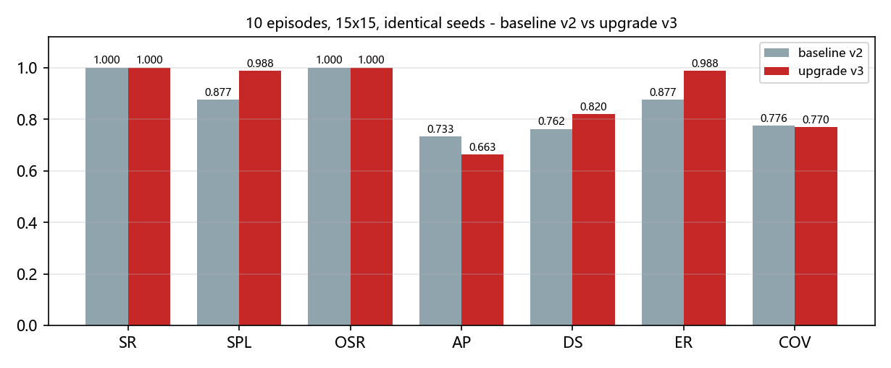
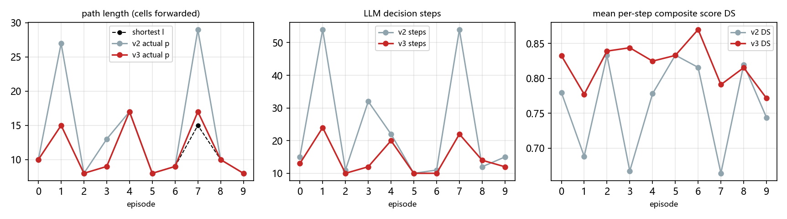
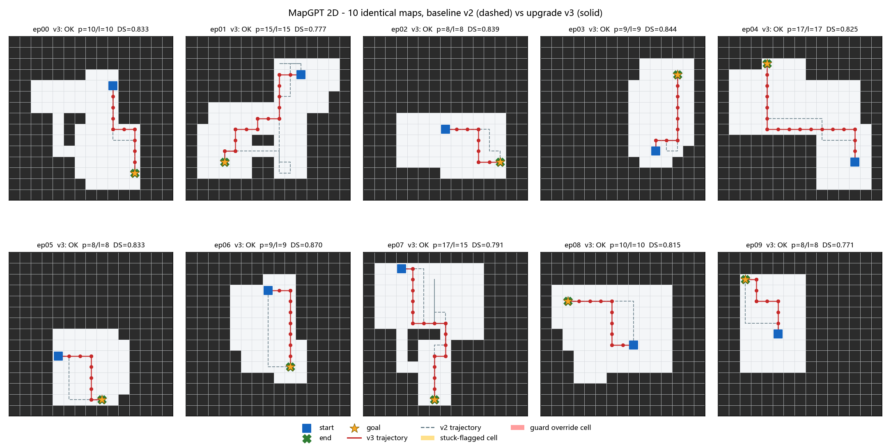
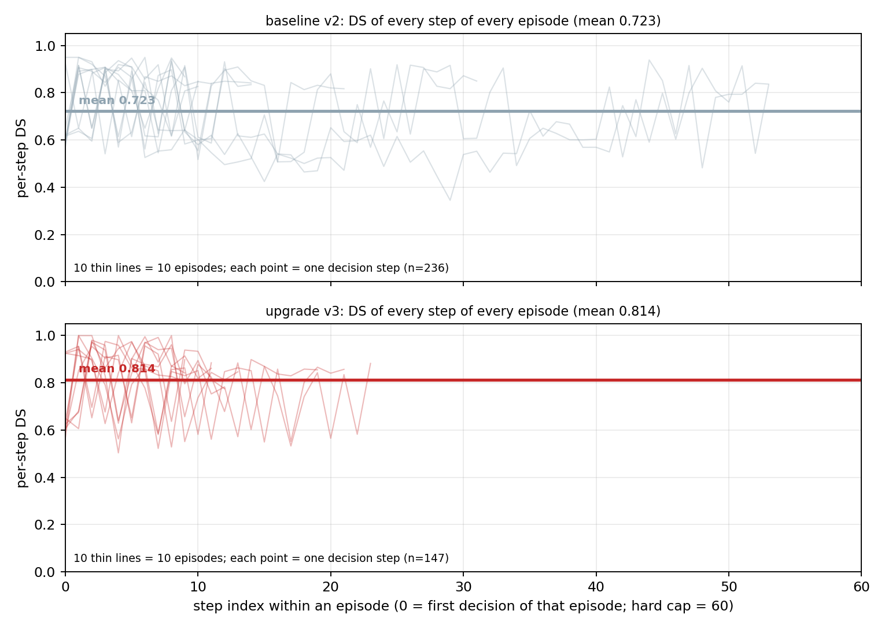
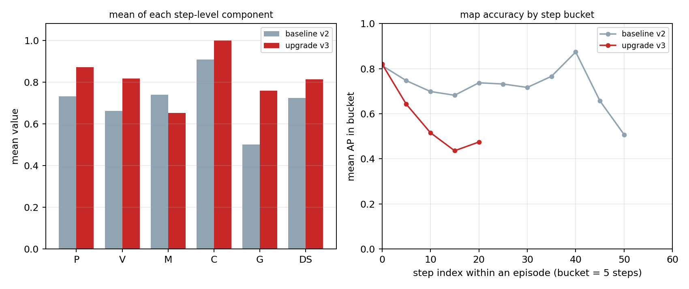

# MapGPT 二维复现与导航决策升级实验

## 摘要

本工作围绕 MapGPT（ACL 2024）"地图引导提示 + 自适应路径规划"的范式，在自建二维网格仿真中完成复现与结构化升级。基线版本（v2）沿用论文风格的提示词结构，仅依赖局部观测与在线拓扑图逐步决策；升级版本（v3）在不训练、不微调模型的前提下，引入锚点排序、未探索路径枚举、卡死检测与两级响应、停止自检四项机制。

在 10 幅 15×15 随机地图、统一随机种子、统一模型与 60 步预算的条件下，v3 的路径效率 SPL 由 0.8765 提升至 0.9882，卡死步占比由 0.1822 降至 0，总决策步数由 236 降至 147，综合分 DS 由 0.7622 提升至 0.8198；建图精度 AP 由 0.7329 降至 0.6627，为唯一负向指标，其原因已定位为提示词长度增长带来的注意力竞争。

---

## 1 项目背景

视觉—语言导航要求智能体依据自然语言指令，在未知室内环境中逐步决策直至抵达目标。MapGPT 的核心思路是将智能体在线构建的拓扑地图以语言形式写入提示词，使大模型在每一步同时获得语言目标与结构化空间记忆，并以多步规划约束局部动作。

本工作不是对官方 Matterport3D / Habitat 基准的复现，而是对该范式的机制验证。所有数值仅用于版本间的内部对比。前期已完成两轮基础实验：20 局 15×15（SR 0.90、SPL 0.9221、AP 0.7691）与 8 局 19×19（SR 1.00、SPL 0.8839、AP 0.7236）。本轮从"能否跑通"转向"决策质量能否被结构性改进"，采用同一批地图进行基线—升级的受控对比。

---

## 2 任务与环境

实验在 15×15 的占据栅格中进行，共 225 格，其中可通行格 47–97 个，均值 69。地图由 3–5 个矩形房间与 L 型走廊随机生成，种子固定为

$$s_i = 20240928 + 17i,\qquad i=0,\dots,9.$$

本轮十幅地图即前期二十局实验中的前十幅，种子一一对应，复用地图是为了控制变量。

动作空间包含前进、左转、右转、停止四种原子动作。每次决策计一步：前进移动一格，转向原地旋转 90°，停止结束回合；撞墙不改变位置但仍消耗一步。单局上限 60 步。

智能体不具备全局地图，仅获得以自身为中心、半径 2 的局部视野（5×5），以符号矩阵与自然语言并列给出，墙体阻断视线，窗口外记为未知。已探索草图、历史动作与拓扑连通句同样以文本写入提示词。

需要说明：指令中直接给出了终点坐标，任务因此退化为"坐标已知、障碍未知"的点对点导航，难度低于原论文的纯语言指令设定。该条件在前期实验中已存在，本轮为保持可比性未作改动。

---

## 3 方法

### 3.1 基线 v2

基线是本项目按论文结构实现的复现版本，并非论文官方代码。每一步发给模型的提示词包含以下内容：

- 任务描述与动作空间（前进、左转、右转、停止）；
- 语言指令（终点方位、房间数量、终点坐标）；
- 当前位姿（坐标、朝向、起点坐标、已走步数）；
- 历史动作序列；
- 局部观测（5×5 符号矩阵与四个方向的文字描述）；
- 已探索区域草图与拓扑连通句（Place i is connected with Places j）；
- 上一步输出的多步规划；
- 输出格式要求（思考、地图、规划、动作四个标签）。

模型每步独立调用，不保留跨步记忆，全部历史由提示词承载。升级版在此基础上追加锚点、frontier 清单、硬规则、卡死警告与子目标标签。

### 3.2 升级 v3

四项机制均在提示词层面或决策回路层面实现。设 q_t 为第 t 步位置，g 为终点，F_t 为当前 frontier 集合。

**U1 锚点排序。** 对每个 frontier 格计算

$$\mathrm{score}(f)=d_{\mathrm{known}}(q_t,f)+\lVert f-g\rVert_1,\qquad f\in F_t,$$

按得分升序取前三名作为候选锚点。其中 d_known 是在已观测可走格上做四连通广度优先搜索所得的步数，第二项为曼哈顿距离。两项等权相加，本质上是 A\* 算法中代价与启发式之和的估计；由于未知墙体不在已知图中，d_known 可能低估真实代价，故仅用于排序。

**U2 未探索路径枚举。** 每步向提示词注入 frontier 清单、四个方向的未探索计数、确认死胡同与重复访问格，并附加硬规则：首选锚点不可达时切换次优锚点；上一步未带来新格则不得重复同一动作；存在 frontier 时不得停止；不得规划穿过已确认的死胡同。

关于"什么情况下放弃当前路线"：每步都会基于当时已知的地图重新计算 frontier 与三个锚点。出现以下任一情况时，规则要求模型放弃当前锚点，改走 ANCHOR_2：当前锚点在已知图上已不可达；该锚点被证明是死胡同；该锚点已经走到；该锚点已从 frontier 中消失。若 ANCHOR_2 同样失效，则依次尝试 ANCHOR_3；三者都失效时，模型从新的 frontier 清单中重新选择。候选顺序由 U1 的两项和决定，即已观测图上到该格的步数加上该格到终点的曼哈顿距离，数值越小越优先，两项等权，不存在百分比权重。

以下为 ep01 第 10 步提示词中的实际片段（节选）：

```
## [v3-U1] Anchor sub-goals (ranked on the OBSERVED graph only)
  ANCHOR_1: Place 31 at cell (6,8) | d_known=3 | manhattan_to_goal=6 | score=9
  ANCHOR_2: Place 27 at cell (6,7) | d_known=2 | manhattan_to_goal=7 | score=9
  ANCHOR_3: Place 34 at cell (7,8) | d_known=2 | manhattan_to_goal=7 | score=9
bearing to destination in plain words: on your front-left (4 cells south, 5 cells west)

## [v3-U2] Unexplored routes you must take into account
total frontier cells (observed but NEVER visited) = 31
NORTH (right): adjacent=FREE_ALREADY_VISITED, unexplored_in_that_direction=19
EAST  (back):  adjacent=FREE_NEVER_VISITED,    unexplored_in_that_direction=22
SOUTH (left):  adjacent=FREE_NEVER_VISITED,    unexplored_in_that_direction=8
WEST  (front): adjacent=FREE_NEVER_VISITED,    unexplored_in_that_direction=6
```

该例中三个候选的分数相同，均为 9，说明存在并列情形；此时按坐标顺序取前三。规则要求优先前往 ANCHOR_1，但允许在一号失效时改用二号或三号。

**U3 卡死检测与两级响应。** 三个检测器分别刻画震荡、重复访问与停滞：

$$
\begin{aligned}
D_1 &: (q_{t-3},q_{t-2},q_{t-1},q_t)=(A,B,A,B),\quad A\neq B,\\
D_2 &: n(q_t)\ge 3,\\
D_3 &: \min_{k=t-5,\dots,t} h(q_k)\ \ge\ h(q_{t-6}),
\end{aligned}
$$

其中 n(q) 为格子 q 的累计访问次数，h(q) 为到终点的曼哈顿距离。任一条件成立即记该步为卡死步。响应分两级：一级为提示层，程序把触发的检测器与处理要求写入当步提示词，动作仍由模型给出；若连续 3 步处于卡死状态且未踏入新格，则升级为二级，由程序在相邻可走格中选择访问次数最少、其次离终点最近的一格执行一步，单局上限 5 次。

**U4 停止自检。** 模型输出停止动作时，以坐标校验：仅当当前位置与终点坐标一致才予放行，否则驳回并在同一步内携带驳回理由重新询问，单局最多驳回 3 次。

本轮实际触发情况：U1 与 U2 在每一步都生效；U3 的三个检测器在升级组一次未触发，因此提示层与接管层两级均未激活；U4 触发 1 次。提示层的警告并非每步都写，只有检测器触发时才会拼入当步提示词。升级组性能提升主要来自 U1 与 U2 提供的结构化探索信息，卡死步的下降正是这一信息进入提示词后的结果。

---

## 4 评价指标

### 4.1 符号约定

| 符号 | 含义 |
|---|---|
| N | 局数 |
| T_i | 第 i 局总步数（含转向与停止） |
| S_i | 第 i 局成功指示变量，抵达终点为 1，否则为 0 |
| l_i | 第 i 局最短路径长度（格边数） |
| p_i | 第 i 局成功前进次数（撞墙与转向不计） |
| d_t | 第 t 步结束后位置到终点的真值最短步数 |
| AP_{i,t} | 第 i 局第 t 步的建图精度 |

**最短路径的计算。** 最短路径由仿真器在评测侧用广度优先搜索求得，记每个可走格到终点的最短步数为 d(v)，满足

$$
d(g)=0,\qquad d(v)=1+\min_{u\in N(v)} d(u),
$$

其中 N(v) 为四连通邻格。第 i 局的最短长度即起点处的取值 l_i = d(s_i)。该计算由运行在虚拟机上的 Python 仿真器完成，不进入提示词；大模型只获得局部观测与终点坐标，最短路径仅作为评分基准使用。

直观地说，广度优先搜索从终点出发：先把与终点直接相邻的可走格标为 1，再把与这些格子相邻的未标记格标为 2，逐层向外扩散，直到覆盖全部可走格。由于每条边的代价都相同（走一格算一步），某个格子第一次被标上的层数就是它到终点的最少步数。以一条三格直线走廊为例，终点为 0，中间格为 1，起点为 2，最短路径长度即为 2。这里的"四连通"指只允许上下左右移动，不允许走对角线，因此距离不会把斜向穿越计为一步。

### 4.2 成功率

$$SR=\frac{1}{N}\sum_{i=1}^{N}S_i.$$

S_i 的判定为回合结束时机器人坐标严格等于终点坐标。该指标只反映"是否抵达"，不区分路径优劣。

### 4.3 标准路径长度加权成功率

$$SPL=\frac{1}{N}\sum_{i=1}^{N}S_i\cdot\frac{l_i}{\max(p_i,l_i)}.$$

其中 l_i 为最短长度，p_i 为实际前进次数。未成功抵达的回合贡献 0；成功回合的得分等于最短长度与实际前进次数之比，绕行越多得分越低，恰好走最短路径时为 1。分母取两者较大值以保证比值不超过 1。

### 4.4 建图精度

$$AP_{i,t}=\frac{1}{2}\left(\mathrm{cell\_acc}_{i,t}+\mathrm{edge\_J}_{i,t}\right),\qquad
AP=\frac{1}{N}\sum_{i=1}^{N}\frac{1}{T_i}\sum_{t=1}^{T_i}AP_{i,t}.$$

其中格子正确率为预测格子中标签正确者所占比例，边一致性为预测连通边与系统观测边的交并比：

$$\mathrm{cell\_acc}=\frac{|\{(x,y):\hat{c}(x,y)=c(x,y)\}|}{|\{(x,y):\hat{c}(x,y)\ \text{已给出}\}|},\qquad
\mathrm{edge\_J}=\frac{|E_{\mathrm{pred}}\cap E_{\mathrm{obs}}|}{|E_{\mathrm{pred}}\cup E_{\mathrm{obs}}|}.$$

符号说明：ĉ(x, y) 为模型在该步地图输出中给出的格子标签（可走或墙），c(x, y) 为真值地图上的实际标签，分子是两者一致的格子数，分母是模型本步给出且在界内的格子总数；E_pred 为模型输出的 Place 连通边集合，E_obs 为系统实际观测到的连通边集合，交并比即两者重合的边数除以两者合计覆盖的边数。

以 ep01 第 6 步为例：模型在 CELL 行报了 29 个格子，ASCII 草图又补充了 25 个，合并去重后共 34 个。逐格比对后 28 个正确、6 个错误（3 个把墙报成可走，3 个把可走报成墙），格子正确率为 28 / 34 = 0.8235。该步预测连通边 42 条，系统观测边 42 条，两者完全一致，边一致性为 42 / 42 = 1.0。该步 AP 为 (0.8235 + 1.0) / 2 = 0.9118。该局 24 步平均下来，格子部分为 0.8033、边部分为 0.6088，得到局级 AP 0.7060。

两项任一缺失时取可用项，均缺失记 0。需要注意两点：其一，格子正确率的分母是模型自行报告的格子数，报告数量少而准确也能获得较高分数；其二，模型虽只有 5×5 的局部视野，却被要求输出全局地图并标注猜测，未观测区域的猜测同样进入分母，因此视野有限并不等于分母小。

### 4.5 逐步综合分

每一步计算五个位于 0 到 1 之间的分项：

$$DS_t=0.30P_t+0.20V_t+0.25M_t+0.15C_t+0.10G_t,$$

$$DS=\frac{1}{N}\sum_{i=1}^{N}\frac{1}{T_i}\sum_{t=1}^{T_i}DS_{i,t}.$$

G 项中的"子目标"是模型在每一步额外输出的一个格子坐标，表示它计划下一步前往的中转点。判断该子目标是否稳定，是为了区分"有计划的推进"和"临时改口"：如果模型频繁更换子目标，往往说明它并未真正选定方向，而是在若干候选之间来回摇摆，这类行为通常伴随重复踏格与绕行。

| 分项 | 含义 | 取值 |
|---|---|---|
| P_t | 进度：本步是否靠近终点 | 靠近一步 1.0，距离不变 0.5，远离 0.0 |
| V_t | 新颖：本步是否开拓新格 | 新格 1.0，旧格 0.5，原地转向 0.25，撞墙 0.0 |
| M_t | 建图：本步地图保真度 | 即 AP_{i,t} |
| C_t | 干净：本步是否出现卡死或接管 | 正常 1.0，有告警 0.5，被接管 0.0 |
| G_t | 承诺：子目标是否稳定 | 不变或已到达 1.0，失效 0.75，无理由更换 0.0，未解析 0.5 |

权重为人工设定，未经数据拟合，主要用于实验内部的逐步诊断。

### 4.6 其他辅助指标

| 指标 | 作用 | 高值意味着 | 低值意味着 |
|---|---|---|---|
| OSR | 轨迹是否曾经过终点 | 1 表示到过终点附近 | 0 表示从未接近终点 |
| NE | 终止位置到终点的最短步数 | 越大越差，0 为停在终点 | 越小越好 |
| ER | 最短长度与实际前进次数之比，不区分成败 | 接近 1 表示路径笔直 | 越小说明绕行越多 |
| COV | 已观测可走格占全部可走格的比例 | 探索范围大，需结合 SPL 解读 | 探索范围小，可能过早收敛 |
| STK | 卡死步数占总步数的比例 | 打转严重，越接近 0 越好 | 0 表示没有触发任何卡死检测 |
| GRD | 程序强制接管的次数 | 程序介入多，模型自主性下降 | 0 表示全部动作由模型给出 |

### 4.7 指标的计算层级

| 层级 | 指标 | 说明 |
|---|---|---|
| 每一步 | P、V、M、C、G | 五项加权得到该步的 DS |
| 每一局 | SR、SPL、AP、DS | 前四项为主指标；AP 与 DS 为步内平均 |
| 每一局 | OSR、NE、ER、COV、STK、GRD | 辅助指标，用于解释主指标的变化 |

---

## 5 实验设置

| 项目 | 设置 |
|---|---|
| 地图 | 10 幅，15×15，种子 20240928+17i |
| 基线 | v2，原始提示词，日志按统一公式重算 |
| 升级 | v3，四项机制全开 |
| 模型 | qwen-plus，单步调用 |
| 步数上限 | 60 |
| 并行 | 虚拟机双进程，ep00–04 与 ep05–09 两路 |
| 调用量 | v3 共 148 次 |

基线与升级使用完全相同的地图、种子、模型与评分代码，差异仅在于提示词与决策回路。

其中"种子"是伪随机数生成器的初始值。地图生成涉及房间数量、位置、尺寸与走廊走向等随机选择；固定种子后，同一序号的地图每次都能被完整复现，轨迹回放与指标核对才有意义。第 i 局使用 20240928 + 17i，即在基准值上按局号步进 17，使十幅地图互不相同且可重复。

本轮十幅地图与前期二十局实验的前十幅完全相同，原因正是种子相同。复用地图是为控制变量：只有地图一致，基线 v2 与升级 v3 的差异才能归因于提示词与决策回路。前期实验余下的十幅地图未参与本轮对比。

---

## 6 实验结果

### 6.1 主表

| 指标 | 含义 | 基线 v2 | 升级 v3 | 变化 |
|---|---|---|---|---|
| SR | 成功抵达终点的局数占比 | 1.0000 | 1.0000 | 0 |
| SPL | 按最短路径加权的成功率，绕行越多得分越低 | 0.8765 | 0.9882 | +0.1117 |
| AP | 模型自建地图与真值地图的一致程度 | 0.7329 | 0.6627 | −0.0703 |
| DS | 逐步综合分，五项加权后取平均 | 0.7622 | 0.8198 | +0.0576 |
| OSR | 轨迹是否曾经过终点 | 1.0000 | 1.0000 | 0 |
| NE | 终止位置到终点的步数误差 | 0 | 0 | 0 |
| ER | 路径效率，不区分成败 | 0.8765 | 0.9882 | +0.1117 |
| COV | 已探索可走面积占比 | 0.7755 | 0.7697 | −0.0059 |
| STK | 卡死步数占总步数比例 | 0.1822 | 0.0000 | −0.1822 |
| GRD | 程序强制接管次数 | 0 | 0 | 0 |
| 总步数 | 全部回合的决策步数之和 | 236 | 147 | −89 |



### 6.2 逐局结果

| ep | 最短 l | v2 前进 p | v3 前进 p | v2 步数 | v3 步数 | v2 DS | v3 DS | v2 AP | v3 AP | v2 卡死步 | v3 卡死步 |
|---|---|---|---|---|---|---|---|---|---|---|---|
| 00 | 10 | 10 | 10 | 15 | 13 | 0.780 | 0.833 | 0.718 | 0.707 | 0 | 0 |
| 01 | 15 | 27 | 15 | 54 | 24 | 0.688 | 0.777 | 0.784 | 0.659 | 11 | 0 |
| 02 | 8 | 8 | 8 | 11 | 10 | 0.833 | 0.839 | 0.860 | 0.687 | 0 | 0 |
| 03 | 9 | 13 | 9 | 32 | 12 | 0.667 | 0.844 | 0.774 | 0.734 | 10 | 0 |
| 04 | 17 | 17 | 17 | 22 | 20 | 0.778 | 0.825 | 0.585 | 0.624 | 0 | 0 |
| 05 | 8 | 8 | 8 | 10 | 10 | 0.833 | 0.833 | 0.773 | 0.722 | 0 | 0 |
| 06 | 9 | 9 | 9 | 11 | 10 | 0.816 | 0.870 | 0.681 | 0.670 | 0 | 0 |
| 07 | 15 | 29 | 17 | 54 | 22 | 0.664 | 0.791 | 0.740 | 0.564 | 22 | 0 |
| 08 | 10 | 10 | 10 | 12 | 14 | 0.820 | 0.815 | 0.679 | 0.675 | 0 | 0 |
| 09 | 8 | 8 | 8 | 15 | 12 | 0.744 | 0.771 | 0.735 | 0.586 | 0 | 0 |

升级组十局全部成功，其中九局走出精确最短路径。十局均未触发任何卡死检测器，没有停滞、重复访问或震荡告警。唯一的偏差出现在 ep07：实际前进 17 次、最短长度 15，多走 2 格。

第 7 局的第一步向东前进，位置到终点的距离由 15 增至 16，随后折返修正，多出的 2 格即由此产生；该局既未触发卡死检测，也没有停止动作被驳回。另需说明步数的构成：升级组 147 步由 111 次前进与 36 次转向组成（左转 21 次、右转 15 次），没有停止动作；基线 236 步由 139 次前进与 97 次转向组成。转向同样消耗决策步数，但不计入路径长度 p_i。

以下数据仅用于对照，属于基线 v2：v2 有三局出现卡死步，累计 43 步，其中 ep01 为 11 步（7 步停滞、3 步停滞加重复访问、1 步重复访问），ep03 为 10 步（全部为停滞），ep07 为 22 步（17 步停滞、5 步重复访问）。三局均未触发震荡，最终都成功抵达。基线不具备检测与干预机制，这些卡死步只能依靠模型在后续步数中自行脱困；升级组则一局都没有出现。









阅读图 3 时需注意，轨迹线不重合并不等于绕路。同一对起点与终点之间往往存在多条长度相同的最短路径，只要实际前进次数等于最短长度，即视为无绕行。图 4 与图 5 的横轴均为"局内步序"而非累计步数：升级组单局最长 24 步，因此曲线在第 20 至 24 步处结束，基线单局最长 54 步，曲线因而延伸到第 50 步之后。

图 3 中蓝色虚线的确定方式如下：先用广度优先搜索得到每个格子到终点的最短步数，再从起点出发，每一步走向一个步数恰好减一的邻格；若存在多个可选邻格，按固定的上、右、下、左顺序取第一个。这样得到的是所有最短路径中的一条，长度为 l。评分只使用长度 l，不使用具体走法，因此选用哪一条不影响任何指标。

### 6.3 机制触发统计

| 机制 | 基线 v2 | 升级 v3 |
|---|---|---|
| 卡死告警步数 | 43 / 236 | 0 / 147 |
| 程序强制接管次数 | 0 | 0 |
| 停止驳回次数 | 0 | 1 |
| 撞墙次数 | 0 | 0 |
| 重复踏格步数 | 35 | 0 |
| 原地转向比例 | 41.1% | 24.5% |

表中卡死告警的 43 步全部出现在基线 v2 的 ep01、ep03 与 ep07；升级组十局均未触发任何检测器。

升级组全部 147 步均由模型自主决策，程序未接管任何一步，说明性能提升来自提示词层面的结构化信息。

---

## 7 讨论

**样本量与天花板效应。** 两组成功率均为 1.0，升级的价值只能通过 SPL 体现。当前 10 局样本不足以支撑统计推断，后续应扩展至 30–50 幅地图。

**建图精度下降。** AP 是唯一负向指标。升级后每步提示词由约 5000 字符增至约 8000 字符，模型注意力更多分配给锚点与规则等决策相关内容，作为副任务的全局建图精度随之下降。分步观察显示前 5 步两组基本持平，差距自第 10 步之后出现，与上述解释一致，但仍需拆分调用做消融验证。

**注意力竞争的含义。** 单次调用中模型能有效利用的上下文是有限的，提示词越长，各段信息分到的相对权重越分散。锚点、规则与 frontier 三块内容与动作决策直接相关，模型把更多注意力放在这些块上，地图输出这类副任务就会被压缩。该解释目前仍是推断，尚未通过实验隔离验证。

**消融实验的设计。** 消融指每次只去掉或替换一个因素，其余条件保持不变，以确认收益具体来自哪一项改动。本实验可设置四组：仅保留 U1；仅保留 U2；保留 U1 与 U2、去掉 U3 与 U4；四项全开。每组在同一批地图上运行，比较 SPL、STK 与步数。针对 AP，另设一组把地图输出拆成独立调用（决策与建图分两次请求），其余不变，观察 AP 是否回到基线水平；若 AP 回升而 SPL 基本不变，即可确认注意力竞争的解释。

**强制接管未触发。** 升级组未出现连续 3 步卡死，程序接管路径在本轮实验中执行零次。当前防卡死的收益来自检测器与提示层，接管机制的有效性需专门构造用例验证。

**任务难度偏宽松。** 指令直接给出终点坐标，使任务退化为坐标已知的点对点导航，明显易于原论文的纯语言设定，结论应在此前提下理解。

---

## 8 结论与后续计划

在受控条件下，结构化提示与决策回路改造显著提升了路径效率与决策稳定性，未出现程序替代决策的现象。建图精度与导航性能在本设计中并不同向，二者不宜共用同一提示通道。

提升 AP 的可行路径有四条：其一，把地图输出从决策提示中拆出，单独调用；其二，把地图改为增量更新，只报新增格子与边，减少重复生成；其三，为地图输出设定结构化模板与长度上限，压缩无关叙述；其四，缩短决策提示中的冗余内容，为地图块留出上下文预算。

后续工作：扩充地图规模至 30–50 幅以消除成功率天花板；构造必然触发连续卡死的用例，验证接管机制；将地图输出拆分为独立调用，完成 AP 归因消融；移除指令中的终点坐标，向论文设定靠拢；固定采样温度并对同一配置重复多次，报告均值与波动。
