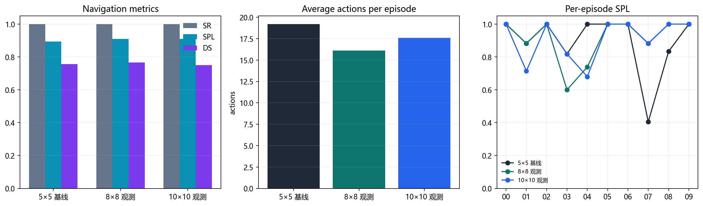
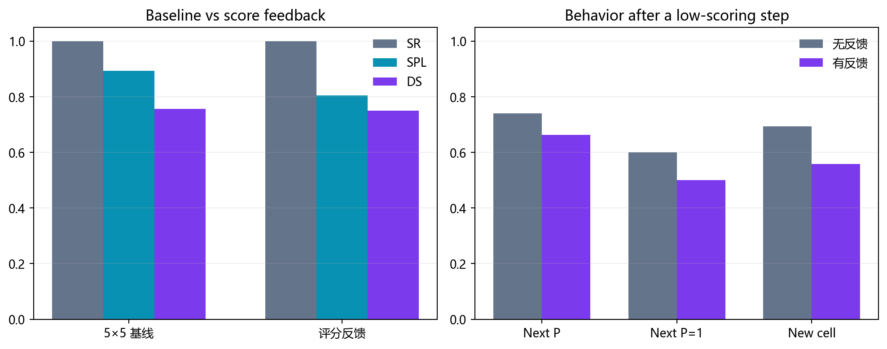
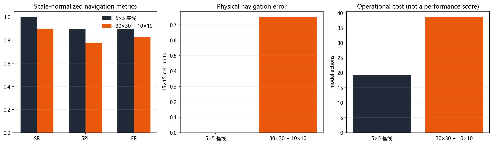
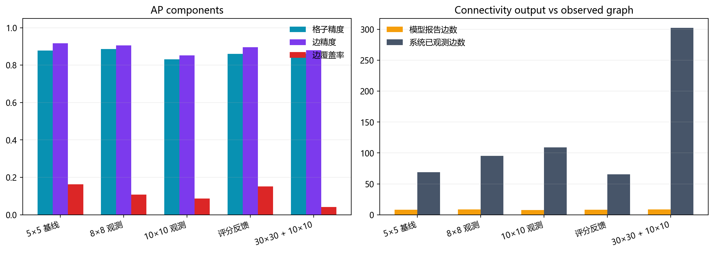
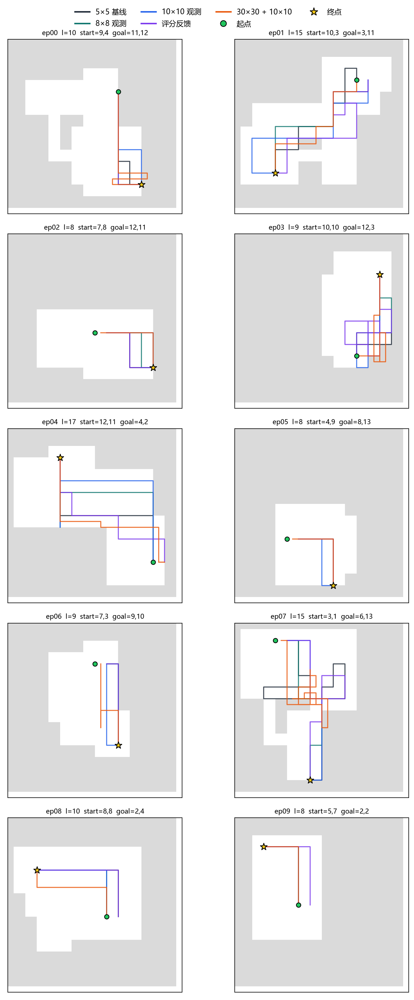
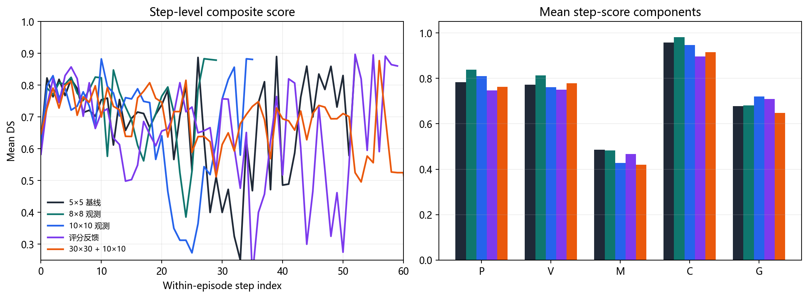

# MapGPT 文本网格导航三任务对比实验

实验基于 v3 的锚点、前沿路径、防卡死与 STOP 坐标门，使用 10 个固定种子和 qwen-plus。所有条件最大 100 步，比较对象均为 5×5 基线。

## 结果摘要

| 任务 | 对比 | 主要结果 | 结论 |
|---|---|---|---|
| 观测范围 | 8×8、10×10 | SPL 0.910、0.909，基线 0.894 | 8×8 点估计最好，10×10 无继续增益 |
| 评分反馈 | 上一步 DS/P/V/M/C/G | SPL 0.805，基线 0.894；平均步数 22.1 对 19.2 | 模型会改变行为，但未提升导航表现 |
| 地图分辨率 | 30×30 + 10×10 | SR 90%，SPL 0.780，物理 NE 0.75 | 公平路径指标下没有性能增益；调用成本增加 |

## 实验设置

- 15×15 地图十幅，种子为 `20240928 + 17i`。
- 动作空间为 `FORWARD/LEFT/RIGHT/STOP`，一次动作移动或转向一步。
- 局部观测以机器人为中心，墙体阻断视线。
- 所有调用使用 qwen-plus、`temperature=0`、`max_tokens=700`。
- 30×30 地图由同一 15×15 地图逐格放大为 2×2 小格，物理布局不变。
- `30×30 + 10×10` 保持与基线相同的物理视野；一次动作移动一个细格，约等于基线半个物理格。
- 每一步先输出动作，再输出最多 16 个关键地图格。
- 观测范围和评分反馈使用 SR、SPL、DS；分辨率对比使用 SR、SPL、ER 和换算后的物理 NE。
- 原始动作数只表示计算成本，不作为跨分辨率导航质量。

## 一、观测范围

| 条件 | SR | SPL | NE | AP | DS | STK | GRD | 步/局 |
|---|---:|---:|---:|---:|---:|---:|---:|---:|
| 5×5 基线 | 100.0% | 0.894 | 0.000 | 0.522 | 0.756 | 0.068 | 3 | 19.2 |
| 8×8 观测 | 100.0% | 0.910 | 0.000 | 0.497 | 0.766 | 0.031 | 1 | 16.1 |
| 10×10 观测 | 100.0% | 0.909 | 0.000 | 0.459 | 0.750 | 0.085 | 4 | 17.6 |

相对基线的配对变化：

| 条件 | ΔSPL [95% CI] | ΔDS [95% CI] | Δ步数 [95% CI] |
|---|---:|---:|---:|
| 8×8 | +0.016 [-0.096, +0.143] | +0.010 [-0.025, +0.044] | -3.100 [-10.100, +1.800] |
| 10×10 | +0.016 [-0.098, +0.143] | -0.007 [-0.060, +0.045] | -1.600 [-9.300, +4.300] |

8×8 的主要收益出现在 ep07：实际前进步数由 37 降到 17，覆盖率达到 96.3%。但各局变化不一致，SPL 区间跨 0。10×10 的 SPL 与 8×8 持平，DS 和 AP 反而下降。

## 二、每一步评分反馈

反馈组在下一步提示词中加入上一步的 `DS/P/V/M/C/G`，其余输入与基线相同。

| 条件 | SR | SPL | DS | STK | GRD | 步/局 |
|---|---:|---:|---:|---:|---:|---:|
| 5×5 基线 | 100.0% | 0.894 | 0.756 | 0.068 | 3 | 19.2 |
| 评分反馈 | 100.0% | 0.805 | 0.750 | 0.172 | 8 | 22.1 |

SPL 配对差为 -0.089 [-0.217, +0.018]。低分后的行为也出现变化：

| 条件 | 下一步前进 | 下一步 P=1 | 踏入新格比例 |
|---|---:|---:|---:|
| 5×5 基线 | 0.741 | 60.0% | 69.4% |
| 评分反馈 | 0.663 | 50.0% | 55.8% |

模型能够读取分数并改变动作，但当前数值反馈没有转化为更好的路径效率。ep03 中，基线为 22 个动作、SPL 0.818；反馈组为 60 个动作、SPL 0.273。

## 三、地图分辨率

分辨率实验采用 `30×30 + 10×10`，使细网格下的局部观测仍覆盖与基线相同的物理范围；起点、终点和房间连通关系保持不变。

| 条件 | SR | SPL | ER | 物理 NE |
|---|---:|---:|---:|---:|
| 5×5 基线 | 100.0% | 0.894 | 0.894 | 0.000 |
| 30×30 + 10×10 | 90.0% | 0.780 | 0.826 | 0.750 |

相对基线的配对差：

| ΔSPL [95% CI] | ΔER [95% CI] | Δ物理 NE [95% CI] |
|---:|---:|---:|
| -0.114 [-0.234, +0.003] | -0.068 [-0.177, +0.033] | +0.750 [+0.000, +2.250] |

原始模型动作数为 19.2 对 38.6，这是细网格下一次动作只移动半个物理格的直接结果，因此只作为调用成本报告，不进入导航质量比较。SPL 和 ER 均按各尺度自身的最短物理路径归一化，SR 与动作粒度无关，物理 NE 已由细格换算回 15×15 格单位。

在该细粒度动作设置下，提高分辨率没有改善 SR、SPL、ER 或物理 NE，并出现 1 次 100 步未到达。该结果不能外推为所有高分辨率地图设计均无效；若要求更严格的等物理动作对照，应将“一次动作移动 2 个细格”实现为宏动作后重新测试。

**关于路径步数是否应进入指标：** SR 不应与步数挂钩；SPL 和 ER 应保留路径距离，但必须使用物理长度并除以该尺度下的最短路径，否则无法区分“到达终点但严重绕路”和“最短路径到达”。不应进入公平性能分数的是原始细格动作数、LLM 调用数和跨尺度直接比较的 DS。当前分辨率结论只采用 SR、SPL、ER 与物理 NE。

## 四、AP 分项分析

原 AP 为 `(格子准确率 + 边 Jaccard) / 2`。边 Jaccard 会同时惩罚漏报和误报，而模型每步只输出约 9 条边；观测图扩大后，漏报会机械性拉低 AP。因此进一步拆成三个分项：

- **格子精度**：模型写出的格子标签中正确的比例；
- **边精度**：模型写出的边中正确的比例；
- **边覆盖率**：系统已观测边中被模型写出的比例。

| 条件 | 格子精度 | 边精度 | 边覆盖率 | 原 AP | 报告边数 | 观测边数 |
|---|---:|---:|---:|---:|---:|---:|
| 5×5 基线 | 0.878 | 0.917 | 0.163 | 0.521 | 8.2 | 69.1 |
| 8×8 观测 | 0.886 | 0.906 | 0.108 | 0.497 | 8.5 | 95.3 |
| 10×10 观测 | 0.830 | 0.852 | 0.086 | 0.458 | 7.5 | 108.9 |
| 评分反馈 | 0.860 | 0.895 | 0.151 | 0.505 | 8.0 | 65.4 |
| 30×30 + 10×10 | 0.861 | 0.879 | 0.041 | 0.451 | 8.9 | 302.7 |

逐条件分析：

- **5×5 基线**：格子精度 0.878、边精度 0.917，原 AP 0.521。误差主要不是写错，而是边覆盖率只有 0.163。
- **8×8**：格子精度升到 0.886、边精度仍有 0.906，但观测边从平均 69.1 增至 95.3，边覆盖率降到 0.108，因此 AP 下降。这里不是地图判断整体变差。
- **10×10**：格子精度降至 0.830、边精度降至 0.852、覆盖率 0.086。可见视野更大时，模型反而更难把更多信息压缩成准确的局部地图。
- **评分反馈**：格子精度 0.860、边精度 0.895、覆盖率 0.151，三项均低于基线；更多历史与数值反馈增加了地图输出的注意力负担，并伴随更长轨迹。
- **30×30 + 10×10**：格子精度 0.861、边精度 0.879，与基线差距不大；但观测边增至 302.7 条，而模型只报告 8.9 条，覆盖率仅 0.041，导致原 AP 明显下降。

**结论：** 原 AP 混合了“预测是否正确”和“是否覆盖足够多的已观测边”，不适合直接跨分辨率比较。后续应以格子精度、边精度衡量地图质量，以边覆盖率单独衡量完整性。分辨率实验的主结论不依赖 AP。

## 五、实际路径

十幅地图使用相同的起点、终点与最短路径。橙色轨迹已换算回 15×15 物理坐标。

逐局路径评分：

| 条件 | ep00 | ep01 | ep02 | ep03 | ep04 | ep05 | ep06 | ep07 | ep08 | ep09 | 均值 |
|---|---:|---:|---:|---:|---:|---:|---:|---:|---:|---:|---:|
| 5×5 基线 | 1.000 | 0.882 | 1.000 | 0.818 | 1.000 | 1.000 | 1.000 | 0.405 | 0.833 | 1.000 | 0.894 |
| 8×8 观测 | 1.000 | 0.882 | 1.000 | 0.600 | 0.739 | 1.000 | 1.000 | 0.882 | 1.000 | 1.000 | 0.910 |
| 10×10 观测 | 1.000 | 0.714 | 1.000 | 0.818 | 0.680 | 1.000 | 1.000 | 0.882 | 1.000 | 1.000 | 0.909 |
| 评分反馈 | 1.000 | 0.652 | 1.000 | 0.273 | 0.895 | 1.000 | 1.000 | 0.600 | 0.833 | 0.800 | 0.805 |
| 30×30 + 10×10 | 0.625 | 1.000 | 1.000 | 0.529 | 0.895 | 1.000 | 0.750 | 0.000 | 1.000 | 1.000 | 0.780 |

完整路线与长度见 [per_episode_path_scores.csv](data/per_episode_path_scores.csv)。

## 六、逐步得分

左图为各步 DS 的局间平均，右图为 P/V/M/C/G 的总平均分。逐步明细见 [step_scores.csv](data/step_scores.csv)。

DS 包含建图项 `M` 和新颖项 `V`，会随网格粒度变化，因此仅用于观察决策过程和稳定性，不作为跨分辨率性能结论。

| 条件 | P | V | M | C | G |
|---|---:|---:|---:|---:|---:|
| 5×5 基线 | 0.784 | 0.772 | 0.486 | 0.958 | 0.677 |
| 8×8 观测 | 0.839 | 0.814 | 0.483 | 0.981 | 0.682 |
| 10×10 观测 | 0.810 | 0.761 | 0.428 | 0.946 | 0.720 |
| 评分反馈 | 0.747 | 0.750 | 0.467 | 0.896 | 0.709 |
| 30×30 + 10×10 | 0.763 | 0.779 | 0.419 | 0.915 | 0.648 |

## 结论

1. 8×8 在当前数据上取得最高 SPL，但 10 张地图的配对区间跨 0，需扩大样本验证。
2. 直接提供完整分数会改变模型行为，但当前实现降低了路径效率。
3. 在当前细粒度动作实现下，同物理视野提高分辨率未改善 SR、SPL、ER 或物理 NE；更严格的结论需要配套等物理宏动作实验。
4. AP 下降主要受边覆盖率影响。跨分辨率评价应改用格子精度、边精度的组合，并单独报告覆盖率。

## 数据

- [条件指标](data/condition_metrics.csv)
- [逐局路径评分](data/per_episode_path_scores.csv)
- [逐步得分](data/step_scores.csv)
- [AP 分解明细](data/ap_components.csv)
- [AP 分项汇总](data/ap_analysis.json)
- [统计结果](data/analysis.json)
- [原始日志、提示词、模型输出与代码](data/raw_results_and_code.tar.gz)

共 50 局、1137 次模型调用，均完成有效记录。
