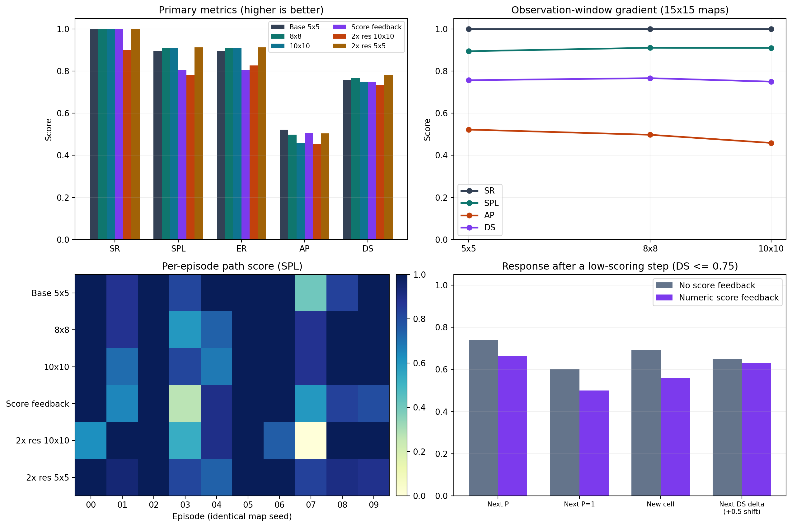

# MapGPT 二维导航：观测范围、评分反馈与地图分辨率

本报告接续 [2026-10-20 的 v2/v3 实验](../10.20汇报/README.md)，在原有四项限制（锚点、前沿路径、防卡死、STOP 坐标门）不变的前提下，完成三项受控对比。实验在自建二维文本网格中运行，不是官方 Matterport3D/R2R 基准。

## 结论

| 问题 | 结果 | 判断 |
|---|---|---|
| 5×5、8×8、10×10 观测范围 | SPL 分别为 0.894、0.910、0.909；8×8 平均少走 3.1 步 | 8×8 是当前点估计最优候选；尚无统计稳定增益，10×10 没有继续提升 |
| 是否向模型提供每一步评分 | SPL 0.894→0.805，步数 19.2→22.1，guard 3→8 次 | 评分会改变决策，但当前直接暴露数值更容易让模型保守、绕路 |
| 地图分辨率提高到 2× | 相同物理视野下 SR 100%→90%，SPL 0.894→0.780，步数 19.2→38.6 | 更高分辨率没有带来增益；现阶段应保留 5×5 观测 |
| 重复输入同一批地图是否造成假提升 | 独立重跑 SPL 0.894→0.913，区间包含 0；1609 次请求缓存命中为 0 | 未发现跨实验“记住地图”或服务端响应复用 |

> 每项只有 10 个配对地图。结论以点估计、配对差异和 95% bootstrap 区间共同判断；区间跨 0 时不声称显著提升。

## 1. 实验设计

十幅地图使用原种子：

$$s_i=20240928+17i,\quad i=0,\ldots,9.$$

动作空间为 `FORWARD/LEFT/RIGHT/STOP`，单局最多 100 步。所有组使用 qwen-plus、`temperature=0`、`max_tokens=700`，并保持 U1–U4 四项约束不变。

本轮统一采用“先输出动作，再输出最多 16 个地图关键格”的精简协议，使矩阵实验可在合理时间内完成。该协议适用于所有条件，因此组间差异仍可比较；由于它与 10.20 报告的长地图协议不同，本轮结论以重新运行的 5×5 基线为准。

| 条件 | 地图 | 局部观测 | 评分反馈 |
|---|---|---|---|
| 5×5 基线 | 15×15 | 5×5 | 无 |
| 8×8 | 15×15 | 8×8 | 无 |
| 10×10 | 15×15 | 10×10 | 无 |
| 评分反馈 | 15×15 | 5×5 | DS、P、V、M、C、G |
| 2× 分辨率，同物理视野 | 30×30 | 10×10 | 无 |
| 2× 分辨率，同格数 | 30×30 | 5×5 | 无 |
| 基线独立重跑 | 15×15 | 5×5 | 无 |

30×30 地图由原 15×15 地图逐格精确放大为 2×2 小格，起点、终点、房间和走廊的逻辑位置不变。因此：

- `30×30 / 10×10`：保持原来的物理视野，但提示词内节点更多；
- `30×30 / 5×5`：保持原来的观测格数，但实际覆盖面积减半。

## 2. 本轮总览

| 条件 | SR | SPL | NE | AP | DS | 步/局 | 调用/局 |
|---|---:|---:|---:|---:|---:|---:|---:|
| 5×5 基线 | 100% | 0.894 | 0.000 | 0.522 | 0.756 | 19.2 | 19.2 |
| 8×8 | 100% | **0.910** | 0.000 | 0.497 | **0.766** | **16.1** | 16.1 |
| 10×10 | 100% | 0.909 | 0.000 | 0.459 | 0.750 | 17.6 | 17.7 |
| 评分反馈 | 100% | 0.805 | 0.000 | 0.506 | 0.750 | 22.1 | 22.1 |
| 30×30 + 10×10 | 90% | 0.780 | 1.500 | 0.452 | 0.734 | 38.6 | 38.6 |
| 30×30 + 5×5 | 100% | 0.913 | 0.000 | 0.505 | 0.780 | 29.9 | 29.9 |
| 基线独立重跑 | 100% | 0.913 | 0.000 | 0.511 | 0.767 | 17.3 | 17.3 |

## 3. 任务一：观测范围

8×8 的正向信号主要来自最困难的 ep07：

- SPL 由 0.405 提升到 0.882；
- 实际前进步数由 37 降到 17；
- 全体平均步数由 19.2 降到 16.1；
- COV 由 0.807 提升到 0.963；
- 卡死率由 6.8% 降到 3.1%。

但 8×8 在 ep03、ep04 上出现反向变化，配对 SPL 差为 `+0.016`，95% 区间 `[-0.096, +0.143]`，尚未达到可宣称显著提升的程度。

10×10 的 SPL 为 0.909，与 8×8 基本持平，但 DS 降到 0.750、AP 降到 0.459、guard 增至 4 次，同时出现 1 次 STOP 驳回。增加可见格子没有自动转化为更准的全局地图或更短轨迹。

**结论：** 下一轮优先采用 8×8；暂不采用 10×10。

## 4. 任务二：每一步评分是否影响下一步

这是严格的 A/B：两组地图、指令、局部观测和四项限制完全一致，只有反馈组额外看到上一步的 `DS/P/V/M/C/G`。

结果出现方向性负作用：

- SPL：0.894 → 0.805，平均差 `-0.089`，95% 区间 `[-0.217, +0.019]`；
- 平均步数：19.2 → 22.1；
- 卡死步占比：6.8% → 17.2%；
- guard 接管：3 → 8 次；
- 低分后真正前进的比例：60.0% → 50.0%；
- 低分后踏入新格的比例：69.4% → 55.8%。

最明显的案例是 ep03：无反馈组 22 个动作、SPL 0.818；反馈组 60 个动作、SPL 0.273，虽然最终仍成功。

模型会读到并响应分数，但直接显示数值更容易让它反复检查、保守转向，而不是纠正导航错误。若要保留反馈，下一轮建议改成定性建议，例如“上一步未接近终点，下一步必须进入未访问格”，不要同时展示五个数值。

## 5. 任务三：地图分辨率

### 5.1 保持物理视野：30×30 / 10×10

| 指标 | 5×5 基线 | 30×30 / 10×10 | 变化 |
|---|---:|---:|---:|
| SR | 100% | 90% | -10 个百分点 |
| SPL | 0.894 | 0.780 | -0.114 |
| AP | 0.522 | 0.452 | -0.070 |
| 平均步数 | 19.2 | 38.6 | +19.4 |
| guard | 3 | 11 | +8 |

ep07 在 100 步上限时仍未到达，最终 NE=15 个细格。高分辨率让提示词里的节点、连通边和坐标序列同时变长，当前模型没有有效利用这些新增信息。

### 5.2 保持观测格数：30×30 / 5×5

SR 仍为 100%，SPL 为 0.913，点估计略高于基线，但置信区间跨 0；平均步数从 19.2 增至 29.9。它没有带来可靠性能增益，只是在更高维动作空间中维持了成功率。

**结论：** 当前没有证据支持“提高地图分辨率会自然提高模型性能”。若必须提高分辨率，优先保留 5×5 格观测；不要直接同比放大到 10×10。

## 6. 逐局路径评分

SPL 定义为：

$$SPL=\frac{1}{N}\sum_i S_i\frac{l_i}{\max(p_i,l_i)},$$

其中 $l_i$ 是起点到终点的最短路径，$p_i$ 是实际成功前进步数，失败局为 0。

| 条件 | ep00 | ep01 | ep02 | ep03 | ep04 | ep05 | ep06 | ep07 | ep08 | ep09 | 均值 |
|---|---:|---:|---:|---:|---:|---:|---:|---:|---:|---:|---:|
| 5×5 基线 | 1.000 | 0.882 | 1.000 | 0.818 | 1.000 | 1.000 | 1.000 | 0.405 | 0.833 | 1.000 | 0.894 |
| 8×8 | 1.000 | 0.882 | 1.000 | 0.600 | 0.739 | 1.000 | 1.000 | 0.882 | 1.000 | 1.000 | 0.910 |
| 10×10 | 1.000 | 0.714 | 1.000 | 0.818 | 0.680 | 1.000 | 1.000 | 0.882 | 1.000 | 1.000 | 0.909 |
| 评分反馈 | 1.000 | 0.652 | 1.000 | 0.273 | 0.895 | 1.000 | 1.000 | 0.600 | 0.833 | 0.800 | 0.805 |
| 30×30 + 10×10 | 0.625 | 1.000 | 1.000 | 0.529 | 0.895 | 1.000 | 0.750 | 0.000 | 1.000 | 1.000 | 0.780 |
| 30×30 + 5×5 | 1.000 | 0.938 | 1.000 | 0.818 | 0.739 | 1.000 | 1.000 | 0.833 | 0.909 | 0.889 | 0.913 |
| 独立重跑 | 1.000 | 0.714 | 1.000 | 0.818 | 1.000 | 1.000 | 1.000 | 0.600 | 1.000 | 1.000 | 0.913 |

全部 70 局的起点、终点、最短路径、实际前进步数、完整路线和各项分数见 [per_episode_path_scores.csv](data/per_episode_path_scores.csv)。

## 7. 数据可靠性

- 70 局全部完成，14 个并行分片退出码均为 0；
- 没有网络失败后的贪心兜底，`fallback_steps=0`；
- 1609 次 API 请求均有不同 `request_id`；
- 每条提示词在首段带唯一编号，最终 `cached_tokens=0`；
- 总 token 用量约 741.6 万；
- 15×15 各组 10 幅地图逐局完全一致；
- 30×30 地图与原图逐格验证，确认为精确 2× 放大。

独立重跑说明 `temperature=0` 仍存在少量服务端波动：SPL 为 0.913 对 0.894，差异区间包含 0。因此报告没有利用单次最佳结果替代受控比较。

## 8. 上周 v3 与本轮的关系

10.20 的 v3 在旧协议下取得：

| 指标 | v2 | v3 |
|---|---:|---:|
| SR | 1.0000 | 1.0000 |
| SPL | 0.8765 | 0.9882 |
| AP | 0.7329 | 0.6627 |
| DS | 0.7622 | 0.8198 |
| 总步数 | 236 | 147 |

v3 证明锚点与前沿信息有效，但 AP 下降也暴露出地图输出与决策争夺注意力的问题。本轮因此继续控制输出长度，并专门测试视野、反馈与空间分辨率。两轮协议不同，数值不直接相减；两轮共同支持“结构化探索信息有效，但增加上下文和数值反馈不一定有效”。

## 9. 下一步

1. 用 8×8 作为候选，扩展到 30–50 幅地图，验证 SPL、步数与卡死率的改善是否稳定。
2. 把数值评分改为单条定性反馈，比较“无反馈 / 结构化建议 / 完整数值”三组。
3. 高分辨率地图暂用 5×5 观测；若要继续扩视野，应先压缩拓扑描述，避免上下文线性膨胀。
4. 将地图重建从动作决策调用中拆出，再比较 AP 与导航性能。
5. 移除指令中的终点坐标，逐步贴近原论文 R2R 设置。

## 10. 文件

- [条件汇总指标](data/condition_metrics.csv)
- [逐局路径与评分](data/per_episode_path_scores.csv)
- [Bootstrap、McNemar 与反馈分析](data/analysis.json)
- [原始日志、每步提示词、模型输出和实验代码](data/raw_results_and_code.tar.gz)
- [上一轮 v3 报告](../10.20汇报/README.md)
- [评分公式](../10.20汇报/data/评分标准_SCORING.md)

指标和路径数据均由虚拟机原始 CSV/JSON 重新计算；原始压缩包内包含 14 个分片的逐局、逐步和原始提示词记录。
