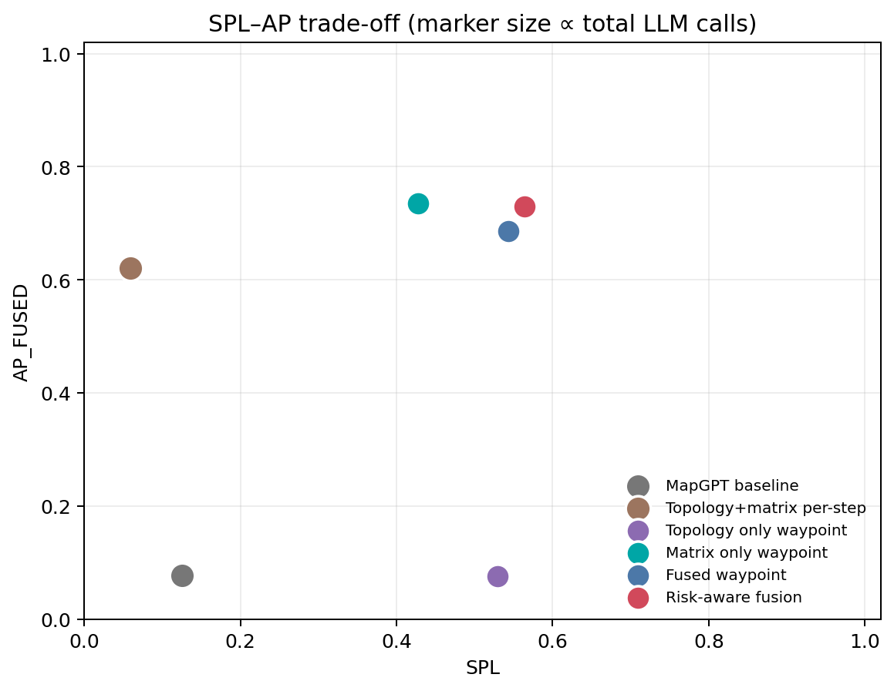
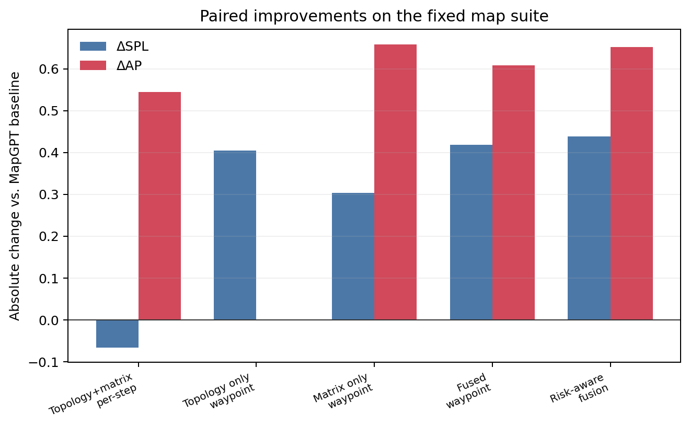

# MapGPT 简化复现的 v5 改进：拓扑–矩阵融合与分层风险规划

日期：2026-11-02  
实验环境：Ubuntu 22.04 虚拟机，`qwen-plus`，`temperature=0.0`  
结论先行：在 8 张相同的高复杂度固定地图上，最终方法把 SR 从 0.125 提升到 0.750，SPL 从 0.125 提升到 0.564，融合地图 AP 从 0.077 提升到 0.730，同时 LLM 调用量减少 81.9%。

## 1. 实验边界

这是基于原项目继续做的 2D 文本网格原理验证，不是官方 MapGPT / Matterport3D / Habitat 复现。所有数值只用于比较本项目内的不同条件，不能直接与 MapGPT 论文表格中的 SR / SPL 对比。

原项目在较简单的 15x15 地图上已经接近饱和：历史 v4 结果中 SR 经常为 1.0，但 SPL 在 0.76–0.98 之间波动，AP 约 0.44–0.54。因此，仅继续在同一批简单地图上提高分数意义不大。v5 将重点放在更复杂、更容易暴露路径选择和地图表示的场景。

## 2. 最近工作给出的直接线索

以下论文是预印本，引用的是其公开摘要中的主要观察：

| 工作 | 与本次改进的关系 |
|---|---|
| MapGPT, arXiv:2401.07314 | 原项目的语言拓扑、在线建图和自适应路径规划基线。 |
| PlatonicNav, arXiv:2606.01788 | 训练-free 地融合几何与语义节点的拓扑地图，说明空间几何与语义关系应联合使用。 |
| AgenticNav, arXiv:2606.10577 | 用紧凑地图记忆和可调用工具降低长文本历史负担，零样本达到较高 SR/SPL。 |
| SimpleVLN, arXiv:2610.23203 | 单轮决策、固定预算记忆和 action chunk 可以显著提高执行效率。 |
| Structure over Reasoning, arXiv:2610.25130 | 让模型提供“方向/前方是否像目标”的证据，而由骨架图、frontier 和测地距离执行路线。 |
| What Should a Navigator Remember?, arXiv:2610.38318 | 将任务记忆、时序记忆和空间几何记忆分开；移除时序记忆会显著增加路径长度。 |
| MATCH, arXiv:2610.38248 | 使用执行感知拓扑图，让高层规划器选择可执行请求，而不是直接逐步控制。 |
| MOON, arXiv:2610.33546 | 偏离路线后需要识别“何时忘记错误历史”并执行恢复，而不是继续套用旧历史。 |

本实验吸收的是这些工作的结构性思想，不是对论文方法或网络的逐行复现。

## 3. 改进方法

### 3.1 同步的文本拓扑 + 占用矩阵

每一步维护两份同步空间记忆：

1. **占用矩阵**：`R=机器人`、`*=已走过`、`.=已知可走`、`#=已知墙/障碍`、`G=已看到的终点`、`?=未知`。未知格不会被伪造为墙或可走格。
2. **骨架拓扑**：路口、死胡同、frontier、机器人和终点的 Place ID 与连通关系，并带有对应矩阵坐标。

两者共享世界坐标。矩阵负责精确几何和局部可执行性，拓扑负责高层连通关系、回路和子目标选择。

### 3.2 前沿级分层控制

不再让 LLM 每一步输出 `FORWARD/LEFT/RIGHT`，而是：

1. 系统在已知图上计算 A* 路径、可达 frontier、到目标下界、信息增益、走廊宽度和死胡同风险；
2. LLM 只选择一个候选 `C1/C2/...`；
3. 确定性执行器沿已知 A* 路径执行一小段 action chunk；
4. 收到新观测后更新矩阵和拓扑，在失效、卡住或到达候选时重规划。

这相当于把 LLM 放在“航点意图”层，把低层安全执行交给几何控制器。

### 3.3 风险感知与恢复

最终方法增加三种执行级约束：

- 候选按“已知 A* 路径长度 + 在未知格乐观可通行时到终点的 A* 下界 + 风险 - 信息增益”排序；
- 如果模型选择了明显更贵、且信息增益不足以补偿的候选，则切换到更安全候选；
- 连续经过没有带来新已观测格或多步重复时，临时否决该路线并重新选择。

地图中也实际加入了办公室隔断、瓶颈、回路、迷宫和死胡同；不是通过移除障碍让任务变简单。


## 4. 实验设计

- 固定基准：`benchmark_maps_v5.json` 的前 8 张地图，2 张办公室场景、2 张回环场景、2 张迷宫、2 张死胡同陷阱。
- 地图大小：21x21。
- 最短路径：20–46 格。
- 地图骨架：64–114 个路口，44–69 个独立回路，5–11 个死胡同端点。
- 所有条件使用完全相同的起点、终点、障碍和语言目标。
- 局部观测：5x5。
- 最大步数：80。
- 模型：`qwen-plus`，温度 0，最大输出 500 tokens。
- 地图文件 SHA-256：`A65B71FAC16B8AE4F82D9F61396024F2B61FA73033723AF76906F168907D1D09`。


## 5. 条件与指标

| 条件 | 说明 |
|---|---|
| `mapgpt` | 原 MapGPT 风格 prompt；每步由 LLM 选低层动作。 |
| `fused_step` | 每步加入拓扑 + 矩阵，但仍由 LLM 逐步选动作。 |
| `topo_waypoint` | 只用文本拓扑，LLM 选航点，A* 执行。 |
| `matrix_waypoint` | 只用矩阵及几何特征，LLM 选航点，A* 执行。 |
| `fused_waypoint` | 拓扑 + 矩阵融合，LLM 选航点，A* 执行。 |
| `risk_waypoint` | 最终方法；在融合航点层增加乐观可达下界、风险否决和恢复。 |

主 AP 使用 `AP_FUSED`：在全部已观测格上评估占用矩阵重建，缺失格按错误计，再与骨架边 Jaccard 加权：

```
AP_FUSED = 0.70 * cell_accuracy + 0.30 * edge_jaccard
```

同时保留原项目的 `AP_LLM_LEGACY`，避免只用新指标讲有利结论。SPL 使用失败局记 0 的标准口径。

## 6. 总体结果

| 条件 | SR | SPL | AP_FUSED | AP_LLM_LEGACY | LLM 调用 | 成功数 |
|---|---:|---:|---:|---:|---:|---:|
| MapGPT 原基线 | 0.125 | 0.125 | 0.077 | 0.398 | 596 | 1/8 |
| 拓扑+矩阵，逐步动作 | 0.125 | 0.060 | 0.621 | 0.404 | 623 | 1/8 |
| 仅拓扑，航点级 | 0.750 | 0.529 | 0.076 | 0.439 | 117 | 6/8 |
| 仅矩阵，航点级 | 0.625 | 0.428 | 0.736 | 0.384 | 129 | 5/8 |
| 融合，航点级 | 0.750 | 0.543 | 0.686 | 0.414 | 116 | 6/8 |
| 融合+风险（最终） | **0.750** | **0.564** | **0.730** | **0.478** | **108** | **6/8** |

最终方法相对原基线的逐地图配对变化：

| 指标 | 绝对变化 | 配对 bootstrap 95% CI | 胜/平/负地图数 |
|---|---:|---:|---:|
| SR | +0.625 | [0.250, 0.875] | 5 / 3 / 0 |
| SPL | +0.439 | [0.140, 0.709] | 5 / 2 / 1 |
| AP_FUSED | +0.652 | [0.516, 0.770] | 8 / 0 / 0 |
| AP_LLM_LEGACY | +0.080 | [0.005, 0.145] | 8 / 0 / 0 |
| LLM 调用/地图 | -61 | — | 总量 596 → 108 |

小样本配对 bootstrap 只是描述不确定性，不是大样本显著性结论。






## 7. 逐地图结果

| 地图 | 最短 | 原基线 成功/实际/SPL/AP | 最终方法 成功/实际/SPL/AP |
|---|---:|---|---|
| office_01 | 26 | 是 / 26 / 1.000 / 0.099 | 是 / 36 / 0.722 / 0.911 |
| office_02 | 34 | 否 / 29 / 0.000 / 0.074 | 是 / 40 / 0.850 / 0.736 |
| loop_01 | 20 | 否 / 41 / 0.000 / 0.051 | 是 / 34 / 0.588 / 0.861 |
| loop_02 | 36 | 否 / 14 / 0.000 / 0.073 | 是 / 50 / 0.720 / 0.335 |
| maze_01 | 36 | 否 / 44 / 0.000 / 0.060 | 是 / 42 / 0.857 / 0.932 |
| maze_02 | 32 | 否 / 29 / 0.000 / 0.087 | 否 / 54 / 0.000 / 0.578 |
| trap_01 | 46 | 否 / 25 / 0.000 / 0.105 | 否 / 56 / 0.000 / 0.735 |
| trap_02 | 41 | 否 / 43 / 0.000 / 0.069 | 是 / 53 / 0.774 / 0.748 |

“实际”是成功前进的格子数；转向只消耗最大步数，不计入 SPL 的路径长度。

## 8. 消融结果说明了什么

1. **单纯矩阵不够。** 仅矩阵的 SR 为 0.625、SPL 为 0.428，低于融合方法的 0.750 / 0.543。矩阵提高了 AP，但缺少拓扑关系时，候选前瞻和跨房间路径选择变弱。
2. **单纯拓扑也不够。** 仅拓扑的 SR 为 0.750，但 AP_FUSED 只有 0.076。它能依靠文本连通关系找路，却无法稳定重建占用矩阵。
3. **不是“每步多给模型一些信息”就会变好。** 在 `fused_step` 中，拓扑和矩阵都存在，但 LLM 仍逐步选动作，SR 为 0.125、SPL 为 0.060，且调用量最高。关键不是信息量，而是把模型放在合适的决策层级。
4. **融合航点同时兼顾两类目标。** `fused_waypoint` 的 SPL 和 AP 分别为 0.543、0.686，说明拓扑负责路由、矩阵负责空间一致性是有效组合。
5. **风险排序进一步改善执行。** 相比 `fused_waypoint`，最终方法 SPL +0.021（相对 +3.8%）、AP +0.044（相对 +6.4%），调用数再减少 6.9%。代价是覆盖率略低、平均 NE 变差；这是为了更直接地走向目标而减少无目的探索。
6. **原基线在办公室顺路径上仍可能更优。** `office_01` 中原基线恰好找到 26 步最短路径，而最终方法走了 36 步。说明当前前沿策略仍有过早探索的倾向，不能宣称所有地图都更好。

## 9. 失败分析

- 最终方法仅在 `maze_02` 和 `trap_01` 达到 80 步上限；这两张图的死胡同和绕行最多。
- `trap_01` 中原基线只前进 25 步就停滞，最终方法已显著探索更多区域，但仍未在预算内到达终点。
- AP 在 `loop_02`、`trap_01` 较低，主要原因是 500-token 输出上限导致长矩阵或拓扑尾部被截断；AP 下降与导航失败同时发生，说明地图输出长度也应按已观测面积自适应压缩。
- 一些地图存在少量不可达的可走格，覆盖率和 AP 的分母会包含这些格，后续应单独报告“主连通分量覆盖率”。

## 10. 相对之前实验的实质改进

- 把评估从容易饱和的简单地图扩展到共享的高复杂度固定地图；
- 从“语言拓扑或图像/矩阵二选一”变成原子级同步的拓扑–矩阵融合；
- 从每步一次 LLM 控制变成 frontier/waypoint 级控制，减少上下文膨胀和动作抖动；
- 加入已知图 A*、乐观可达下界、候选风险否决和失败路线恢复；
- 把 AP 从容易受少量输出格影响的旧口径，扩展为完整已观测地图重建指标，同时保留旧口径；
- 用相同地图、相同模型和相同步数预算做六组条件对照，给出逐地图配对差异。

## 11. 下一步建议

优先级从高到低：

1. **学习一个很小的候选重排器。** 用当前日志训练 1M–10M 参数的模型或梯度提升树，输入候选的路径、信息增益、死胡同风险、历史失败次数，输出选择概率。目标是解决 `office_01` 的探索偏置，同时保持空泛化。
2. **加入动作完成的执行价值。** 借鉴 MATCH，把每个候选的成功率、绕路和转向成本加入执行感知图，而不是只看向终点距离。
3. **做真正的偏离恢复。** 借鉴 MOON，增加“偏离判定器”和短期历史清除策略；当前恢复只是基于无新格/重复访问的启发式。
4. **自适应地图压缩。** 对矩阵按房间或 2x2 区块压缩，保证 AP 长矩阵不会被输出上限截断，同时降低 token 成本。
5. **更大规模测试。** 扩展到 32x32、动态障碍和多楼层；至少 8 张图只能作为方向性验证，不能替代大样本结论。
6. **视觉输入版本。** 若资源允许，将矩阵分支替换成局部占据栅格/深度特征，再把语义拓扑作为另一个分支，向 MapGPT 原始视觉设置靠近。

## 12. 复现

代码、固定地图、逐 episode/step 结果、分析 CSV/JSON 和本报告打包在 `mapgpt_v5_experiment_bundle.tar.gz`。主入口为 `mapgpt_v5.py`，口径见 `SCORING_V5.md`，运行步骤见 `README_EXPERIMENT_V5.md`。
