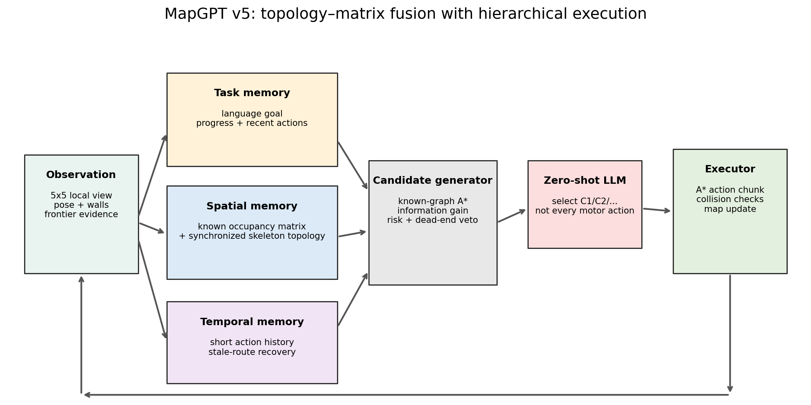
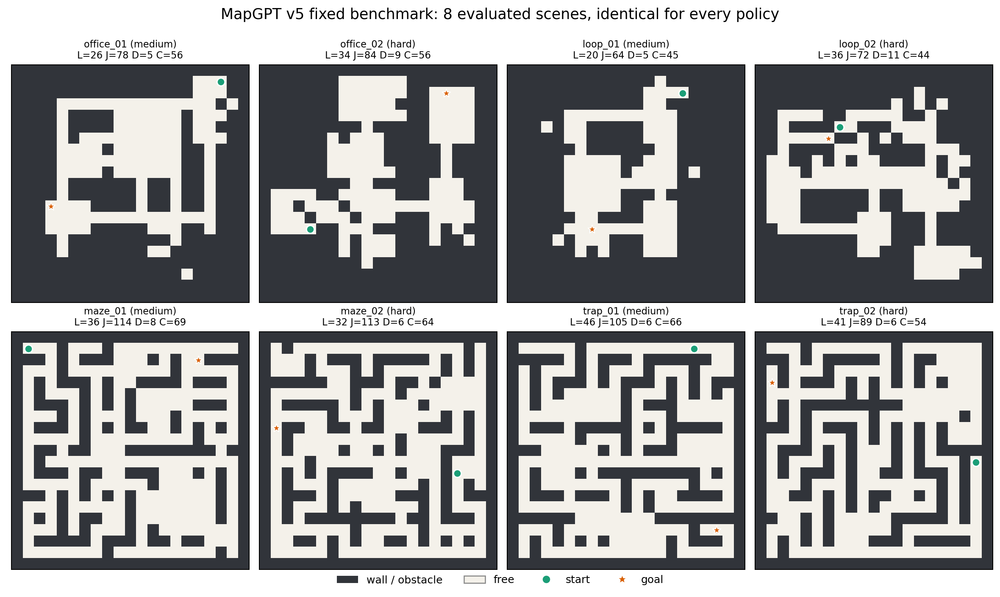
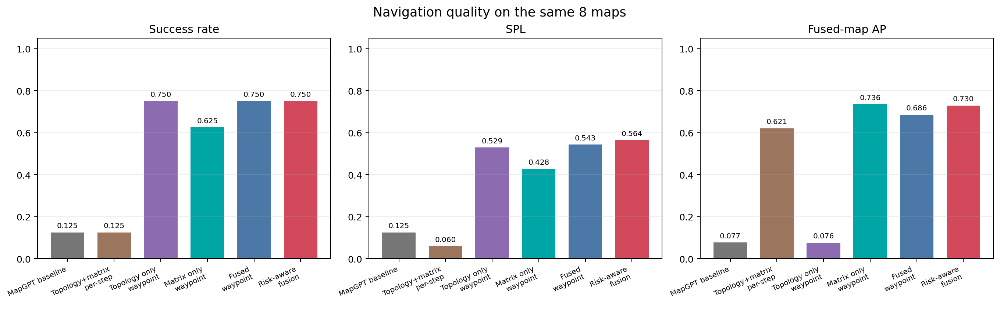

# MapGPT 简化复现：拓扑–矩阵融合与分航点规划

日期：2026-11-02

本实验在 2D 文本网格中验证 MapGPT 的改进方向，不是官方 Matterport3D / Habitat 复现。所有条件共用 8 张固定地图、`qwen-plus`、温度 0、5×5 局部观测、80 步上限和相同起终点。

**结论：**拓扑负责连通关系，矩阵负责几何可执行性；LLM 选择 frontier 航点，A* 负责低层路径。最终方法将 SR 从 0.125 提升至 0.750，SPL 从 0.125 提升至 0.564，融合地图 AP 从 0.077 提升至 0.730，同时将 LLM 调用从 596 次降至 108 次。

## 方法结构



机器人每步根据局部观测更新两份同步空间记忆：

1. **占用矩阵**：`R` 机器人、`*` 已访问、`.` 已知可走、`#` 墙/障碍、`G` 已观察到的终点、`?` 未知。
2. **文本拓扑**：路口、死胡同、frontier 和终点之间的 Place ID 连通关系。

LLM 只选择高层航点；A* 在当前已知可走格上规划路径，底层控制器负责转向、前进和碰撞检查。若路线失效、到达航点或长时间没有新观测，则重新规划。

## 六组实验条件

| 条件 | 地图表示 | LLM 决策 | 低层执行 | 风险/恢复 |
|---|---|---|---|---|
| `mapgpt` | 原 MapGPT 风格：局部观测、已探索草图、拓扑 | 每步选择 `FORWARD/LEFT/RIGHT/STOP` | LLM 直接控制 | 非终点 STOP 最多驳回 3 次 |
| `fused_step` | 加入占用矩阵、骨架拓扑和候选特征 | 每步选择原始动作 | LLM 直接控制 | 非终点 STOP 驳回 |
| `topo_waypoint` | 文本拓扑和候选表，不含全局矩阵 | 选择 `C1/C2/...` | A* 执行 | 无硬风险否决 |
| `matrix_waypoint` | 占用矩阵和候选表，不含骨架拓扑 | 选择 `C1/C2/...` | A* 执行 | 无硬风险否决 |
| `fused_waypoint` | 拓扑 + 矩阵融合 | 选择 `C1/C2/...` | A* 执行 | 风险仅参与候选打分 |
| `risk_waypoint` | 拓扑 + 矩阵融合 | 选择 `C1/C2/...` | A* 执行 | 执行代价排序、风险否决、失败路线恢复 |

这六组是分阶段消融，不是六个不同地图或不同模型。

## 原始动作与航点的区别

### 原始动作

LLM 每次只走一个环境步：

- `LEFT/RIGHT` 原地转向；
- `FORWARD` 前进一格；
- `STOP` 请求结束。

优点是能近距离处理突发障碍；缺点是长路径上要反复判断朝向，动作错误会累积，而且每一步都要调用 LLM。

### 航点

LLM 只输出一个候选，例如 `<TARGET>C1</TARGET>`。系统随后：

1. 在已知地图上计算到 C1 的 A* 路径；
2. 自动完成必要的转向和前进；
3. 到达 C1 后更新地图并重新选择下一航点。

航点不一定是相邻格。候选来自“已观察到、未访问且邻近未知区域”的 frontier 聚类；每个簇保留一个代表点，最多取前 6 个，已观察且可达的终点则额外作为 `GOAL` 候选。系统先按路径长度、信息增益、到终点距离和风险排序，LLM 再从编号候选中做最终选择。

最终风险条件使用：

```text
执行分数 =
    已知 A* 路径长度
  + 未知区域乐观可达距离
  + 2.2 × 风险
  - 0.9 × 信息增益
```

一个航点需要走多少步并不固定。候选记录的是 `path_len`，表示 A* 前进边数；实际环境步还需要加上转向。例如 `office_01` 的第一个航点需要前进 4 格，但包含转向共消耗 7 个环境步。

这种分层方式明显优于逐步动作：原基线在失败局中有 6–38 次撞墙，最终航点方法在全部 8 局中撞墙次数为 0。

## 终点信息

本实验从开始就把终点网格坐标提供给机器人，但没有给出路线、墙体和连通关系。机器人必须通过局部观测逐步探索，直到终点被观察到且在已知图上可达，才能把 `GOAL` 加入候选。

结束条件使用坐标门控：只有 `robot_xy == destination_xy` 才允许成功结束，不根据“看起来接近终点”提前停止。

## 固定地图



8 张地图均为 21×21，包括办公室隔断、回环、迷宫、瓶颈和死胡同。最短路径为 20–46 格，所有条件使用完全相同的起点、终点和障碍。

## 总体结果



| 条件 | SR | SPL | AP_FUSED | 旧 AP 口径 | LLM 调用 |
|---|---:|---:|---:|---:|---:|
| MapGPT 原基线 | 0.125 | 0.125 | 0.077 | 0.398 | 596 |
| 拓扑+矩阵，逐步动作 | 0.125 | 0.060 | 0.621 | 0.404 | 623 |
| 仅拓扑，航点级 | 0.750 | 0.529 | 0.076 | 0.439 | 117 |
| 仅矩阵，航点级 | 0.625 | 0.428 | 0.736 | 0.384 | 129 |
| 融合，航点级 | 0.750 | 0.543 | 0.686 | 0.414 | 116 |
| **融合+风险，最终** | **0.750** | **0.564** | **0.730** | **0.478** | **108** |

`AP_FUSED` 是本项目定义的已观测地图重建精度；旧 AP 口径单独保留。它不能与官方 MapGPT 的 AP 数值直接比较。

最终方法相对原始动作基线：

- SPL：`0.125 → 0.564`；
- AP_FUSED：`0.077 → 0.730`；
- 旧 AP：`0.398 → 0.478`；
- 成功地图：`1/8 → 6/8`；
- LLM 调用减少 81.9%。

仅矩阵条件的 AP 较高，但 SR/SPL 低于融合方法；仅拓扑条件 SR/SPL 较高，但 AP 很低。这说明两种表示确实互补。

## 失败分析

最终方法仅在 `maze_02` 和 `trap_01` 失败。两局均为 `max_steps`，**没有提前 STOP、没有原地卡死、没有撞墙**。

| 地图 | 终点 | 最终位置 | 距终点 | 成功前进 | 撞墙 | 恢复 | 主要问题 |
|---|---|---:|---:|---:|---:|---:|---|
| `maze_02` | `(1,8)` | `(8,19)` | 18 格 | 54 格 | 0 | 1 | 前半程多次换 frontier，向北侧终点回溯太晚；有重复访问，但机器人持续移动 |
| `trap_01` | `(18,17)` | `(10,17)` | 8 格 | 56 格 | 0 | 1 | 先探索了较远区域，最后回到目标同一行时步数预算耗尽 |

原基线的 7 次失败也全部是 `max_steps`，没有提前停止；但其失败局出现 6–38 次撞墙，说明逐步动作控制更容易发生无效转向和碰撞。

## 主要结论

1. 单纯矩阵不够：空间精度高，但跨房间路线选择较弱。
2. 单纯拓扑也不够：能找路，但难以稳定重建占用地图。
3. 信息越多不等于效果越好；如果仍让 LLM 逐步控制，矩阵和拓扑反而会增加决策负担。
4. 最佳结构是“LLM 选择语义航点，A* 执行几何路线”。
5. 当前主要瓶颈已从碰撞变成 frontier 选择和回溯策略；下一步适合训练一个小型候选重排器。

## 文件

- `figs/`：方法结构、固定地图、总体结果；
- `data/aggregate.csv`：总体指标；
- `data/per_map.csv`：逐地图结果；
- `data/analysis.json`：配对统计；
- `code/`：核心实验代码与固定地图；
- `data/raw_results_and_code.tar.gz`：完整原始结果与全部代码。
