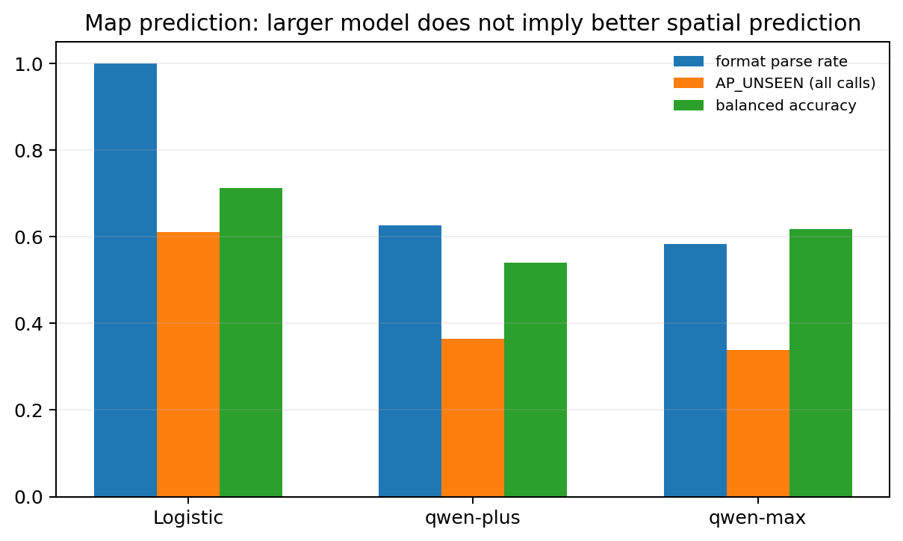
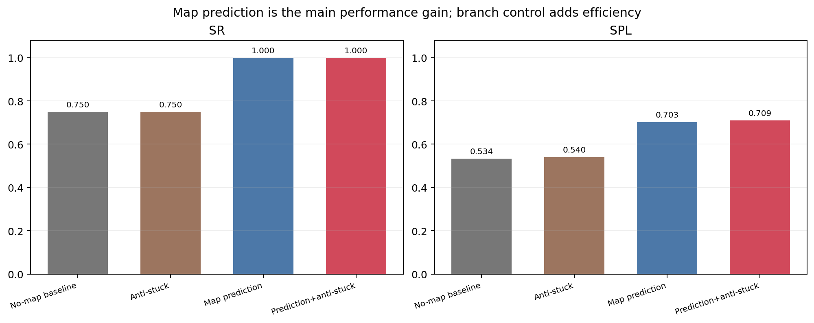
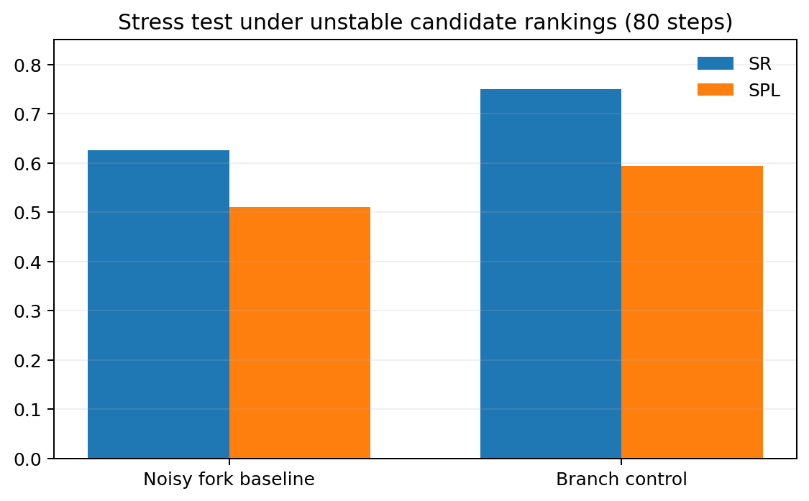
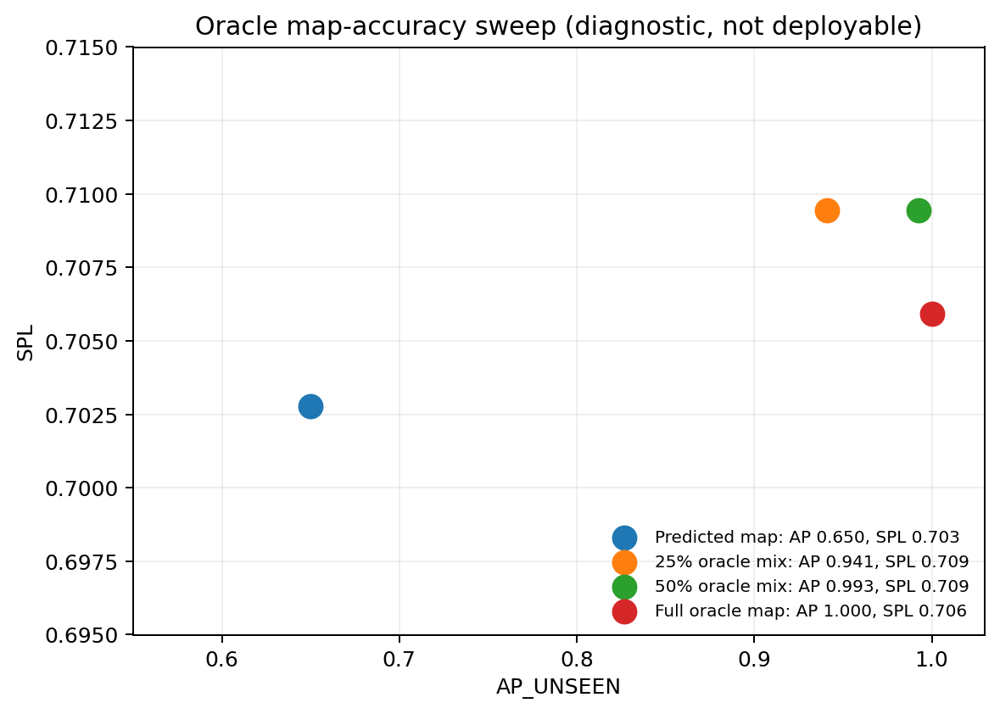

# MapGPT 简化研究 v6：原论文差异、防卡死、地图预测与 AP 实验

日期：2026-11-09  
实验：8 张固定 21×21 地图，`qwen-plus / qwen-max` 对照  
结论先行：**地图预测是主要增益，分支防卡死/预算回溯主要改善路径效率；AP 可以作为地图质量指标，但不能单独当作卡死预测器。**

## 1. 与原论文的核心差异

原 MapGPT（ACL 2024）在离散 R2R 图上运行。LLM 每一步从当前相邻可导航视点中选择一个动作，同时输出多步文字计划；实际状态转移仍只是一次单步视点选择。原论文没有显式候选分数，也没有 A* 自动执行。

本研究的控制方式：

```text
局部观测 + 占用矩阵 + 文本拓扑
        ↓
frontier / GOAL 候选生成
        ↓
规则打分 +（可选）LLM 选择
        ↓
A* 在当前已知地图上规划到选中航点
        ↓
底层动作执行、地图更新、岔路防卡死与预算回溯
```

| 方面 | 原 MapGPT | 本研究 v6 |
|---|---|---|
| 环境 | Matterport3D 离散视点图 | 自建二维占用网格 |
| LLM 动作 | 选择一个相邻可导航视点 | 可选择一个 frontier/GOAL 航点 |
| 执行粒度 | 一步一个视点 | A* 执行多步已知路径 |
| 地图表示 | 在线文本拓扑 | 文本拓扑 + 同步占用矩阵 |
| 显式打分 | 无 | 有：路径长度、信息增益、风险、预测距离 |
| A* | 无 | 用于已知图航点段执行 |
| 多步计划 | LLM 文本计划，主要辅助推理 | 选中航点由执行器实际执行 |
| 防卡死 | 依靠计划回溯 | 显式分支失败、重复边检测、预算回溯 |
| 地图预测 | 主要记录已观察节点 | 未见区域占用补全并参与航点排序 |

因此，航点控制、A*、矩阵融合、显式防卡死和地图补全都是本研究新增内容，不能归入原论文原有机制。

## 2. 本轮修正了旧实验的一处泄漏

旧 v5 的条件打分和 prompt 使用了真实最短路径 `env.shortest_len`。v6 已全部移除：

- 航点评分只使用已经观察到的地图；
- 路径长度来自当前已知图 A*；
- 终点距离使用任务公开的目标坐标；
- 未知区域距离使用“乐观但带墙惩罚”的预测 A*；
- 真实最短路径只用于最后计算 SPL，不再参与决策。

主实验统一将最大步数提高到 100，所有对照条件使用相同地图和预算。

## 3. dPWM 与相关前沿工作

### dPWM

教师提供的论文：

- **dPWM: Autonomous Exploration via Diffusion-Based Map Prediction Guided Planning**
- ICRA 2026，DOI: `10.1109/ICRA57385.2026.11696058`

核心思想：

1. 用 DDPM 从部分观测预测完整结构图的概率分布；
2. 使用位置热图和 cross-attention 加强局部区域感知；
3. 将预测图交给 Watchman Route Problem（WRP）求解器生成全局探索路线；
4. 论文报告 HouseExpo 路径长度降低 18.53%，Dungeon 跨域降低 16.37%。

对本研究最有用的不是直接训练扩散模型，而是：

> 地图不应只被动记录已经看过的格子，还应预测未知区域，并把预测结果转化为规划用的距离/价值。

### 其他相关工作

- **PLMD**（arXiv:2605.05960）：用标签地图扩散补全未知障碍和语义区域。
- **PaceForecaster**（arXiv:2512.21398）：用语言条件预测局部地图和子目标，报告相对局部地图基线提升 36%。
- **InsightMap**（arXiv:2609.37187）：将动作后的地图生成作为辅助监督，R2R-CE 上 SR/SPL 分别提高 4.3/3.2 个点。
- **MetaNav / Stop Wandering**（arXiv:2604.02318）：专门指出贪心 frontier 会造成局部震荡和重复访问，需要进度监控和反思修正。
- **MOON**（arXiv:2610.33546）：偏离后需要判断何时清除错误历史并恢复，而不是继续行为惯性。

这些工作共同支持本轮设计：地图预测负责“看得更远”，分支记忆和恢复负责“不要一直走错”。

## 4. 地图预测实验设计

地图预测输入为实际探索轨迹在 step 5/15/30 的部分观测；输出为 21×21 未观察区域占用预测。8 张测试地图共 24 个固定快照。

非 LLM 预测器：

- 使用保留地图和额外生成的训练地图拟合小型逻辑分类器；
- 特征包括邻域自由/墙计数、相反方向一致性、最近已知自由/墙距离、行列占用比例；
- 不训练大神经网络，不调用 LLM；
- 测试地图不参与模型拟合。

LLM 预测：

- `qwen-plus`
- `qwen-max`

`qwen3.8-flash`、`qwen3.8-max` 在当前 DashScope 兼容接口持续超时，未得到可解析输出，因此没有纳入数值表。

## 5. 地图预测结果

| 方法 | 格式解析率 | AP_UNSEEN（全部调用） | AP_UNSEEN（仅解析成功） | 平衡准确率 |
|---|---:|---:|---:|---:|
| 全部预测为墙（多数类基线） | 100% | 0.600 | 0.600 | 0.500 |
| 非 LLM 结构预测器 | 100% | **0.611** | **0.611** | **0.711** |
| qwen-plus | 62.5% | 0.364 | 0.583 | 0.540 |
| qwen-max | 58.3% | 0.338 | 0.579 | 0.617 |

结论：

1. **大模型不等于更好的地图预测。** qwen-max 在格式稳定性和全部调用 AP 上都没有超过 qwen-plus，也明显低于非 LLM 结构预测器。
2. LLM 能生成部分结构，常见问题是漏行、行宽不一致、覆盖已观察格错误。
3. 未观察区域中约 60% 是墙，所以“全部预测为墙”也能获得 0.600 普通准确率；必须同时看平衡准确率与自由/墙 F1。
4. 非 LLM 结构预测器虽然有最高的平衡准确率，但普通 AP 只略高于多数类基线，说明当前补全能力仍然有限。



## 6. 导航实验结果

所有条件使用 8 张相同地图，最大步数 100。

| 条件 | SR | SPL | NE | 撞墙 | 分支恢复 |
|---|---:|---:|---:|---:|---:|
| 无地图预测基线 | 0.750 | 0.534 | 2.75 | 0 | 0 |
| 仅防卡死 | 0.750 | 0.540 | 3.88 | 0 | 5 |
| 地图预测 | **1.000** | 0.703 | 0.00 | 0 | 0 |
| **地图预测 + 防卡死** | **1.000** | **0.709** | **0.00** | **0** | **4** |

主要发现：

- 地图预测将 SR 从 0.750 提升到 1.000，SPL 提升约 16.9 个点；
- 防卡死单独使用时，SR 不变，SPL 小幅提高约 0.7 个点；
- 两者结合后，SPL 再提高约 0.7 个点；
- 所有条件撞墙均为 0，说明当前主要问题不是低层碰撞，而是探索路线和步数预算；
- 8 张地图样本较小，地图预测的配对 SPL 置信区间仍包含 0，应视为方向性结果。



## 7. 岔路防卡死与压力测试

最终实现包含：

1. **分支记忆**：记录选中的第一个岔路、信息增益、目标进展和路线成本；
2. **失败分支惩罚**：绕路且离目标更远，或成本高但几乎没有新信息时，增加该分支代价；
3. **重复边和震荡检测**：同一边反复穿越时重新规划；
4. **预算回溯**：超过 45% 步数后，降低信息增益权重，优先选择更接近目标的 frontier；
5. **暂时否决**：失败分支短期降权，而不是永久删除。

由于确定性基线很少真正原地打转，额外增加了“候选排名抖动”压力测试：在分数接近的两个岔路之间周期性交换选择，模拟 LLM/地图估计不稳定。

| 80 步压力测试 | SR | SPL | 恢复次数 |
|---|---:|---:|---:|
| 岔路抖动基线 | 0.625 | 0.510 | 0 |
| 岔路抖动 + 防卡死 | **0.750** | **0.593** | **4** |

在候选排序不稳定的情况下，防卡死将 SR 提高 12.5 个点、SPL 提高 8.3 个点。它不是当前 8 张地图的主要增益来源，但对有岔路抖动/重复回溯的系统有价值。



## 8. AP 是否有助于防止卡死

不能直接把 AP 放进在线策略，因为 AP 计算需要完整真值地图。本轮做了三种分析：

### 8.1 AP 与成功/失败的相关性

在主实验各条件中，episode 平均 AP 与实际成功标签的相关系数约为 `-0.04`，基本没有正相关。难图能有较高预测 AP，但仍在预算内走错分支；简单图可能成功但平均 AP 不高。

结论：

> **AP 不是有效的卡死预测器。** 它描述地图补全质量，不描述历史路线是否已经进入低收益分支。

### 8.2 用真实 AP 做开关（仅诊断，不可部署）

当 AP 低于阈值时关闭地图先验，结果下降为：

- SR = 0.750
- SPL = 0.521

比始终使用预测地图更差，说明“预测 AP 不高”不代表预测信息完全无用。

### 8.3 提高预测图精度的受控扫描（使用真值，仅诊断）

将预测概率与真实地图按 0%、25%、50%、100% 混合：

| 预测图 | AP_UNSEEN | SR | SPL |
|---|---:|---:|---:|
| 非 LLM 预测图 | 0.650 | 1.000 | 0.703 |
| 25% 真值混合 | 0.941 | 1.000 | **0.709** |
| 50% 真值混合 | 0.993 | 1.000 | **0.709** |
| 100% 真值图 | 1.000 | 1.000 | 0.706 |

提高地图精度后，SPL 只提高约 0.6 个点，SR 没有继续提高，并在完美真值图时略有回落。说明：

1. 预测地图的价值主要来自“为未知区域提供方向性先验”；
2. 当预测已经足以选到正确区域后，继续提高逐格 AP 的边际收益很小；
3. 防卡死必须依赖路线历史、分支收益和目标进展，不能只依赖地图 AP。



## 9. 如何真正提高地图预测精度

按优先级：

1. **结构化地图补全模型**：借鉴 dPWM/PLMD，用轻量 CNN-U-Net 或扩散模型预测未知占用和墙连续性，而不是让 LLM直接输出长矩阵。
2. **地图生成作为辅助监督**：借鉴 InsightMap，预测动作后的地图，而不是只预测最终静态地图。
3. **语言条件预测**：借鉴 PaceForecaster，把“厨房/走廊/门”等语言线索作为地图补全条件。
4. **空间一致性损失**：墙线连续性、走廊宽度、连通性和自由空间先验，应直接进入损失函数。
5. **模型选择**：不能默认大模型更好；本轮 qwen-max 的地图解析率和 AP 均未超过 qwen-plus。
6. **输出格式与验证**：仍需验证行列尺寸、已观察格一致性和边界连通性；地图预测精度不仅取决于模型能力，也取决于格式可靠性。

## 10. 失败分析与限制

- 主实验的 8 张地图规模较小，配对置信区间较宽；
- 分支抖动是基于真实失败的合成压力测试，不等同于真实 LLM 行为；
- 非 LLM 地图预测器的普通 AP 只比多数类基线高约 1.1 个百分点；
- LLM 地图预测格式失败较多，不能直接用于闭环；
- 真值混合扫描只用于因果诊断，不是可部署方法；
- 地图仍是静态二维占用，没有动态障碍、语义房间和视觉输入；
- 没有直接复现 dPWM 的扩散模型和 WRP 求解器，只吸收“预测图引导规划”的核心思想。

## 11. 建议的下一步

1. 在小规模结构补全网络中加入 U-Net 和走廊连续性损失，先把 AP_UNSEEN 提高到稳定超过 0.70；
2. 将预测图输出改为“障碍概率 + 连通区域”，避免 LLM 直接生成长字符矩阵；
3. 保留分支记忆和预算回溯，并把历史收益作为单独价值项，而不是混入地图风险；
4. 在更多地图上验证 AP、平衡准确率、SR、SPL 的相关性；
5. 若继续做论文，可形成两类清晰贡献：
   - **方法贡献**：拓扑-矩阵融合、航点级 A*、分支防卡死；
   - **表示贡献**：结构地图预测与 AP/平衡准确率联合评估，而不是仅追求大模型。

## 12. 数据与代码

- `data/aggregate.csv`：总体指标；
- `data/per_map.csv`：逐地图差异；
- `data/analysis.json`：配对 bootstrap 结果；
- `data/map_prediction_summary.csv`：模型地图预测汇总；
- `code/`：地图预测、导航、分析和绘图代码；
- `data/raw_results_and_code.zip`：完整结果与代码。

