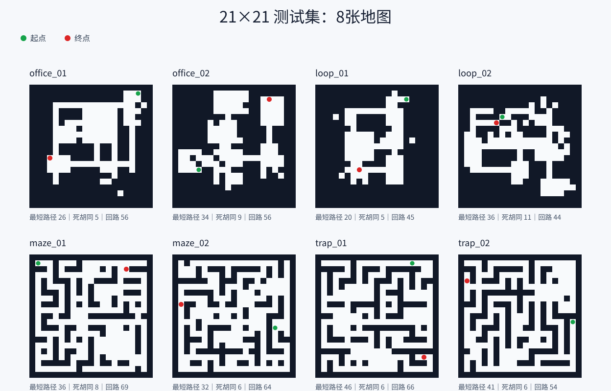
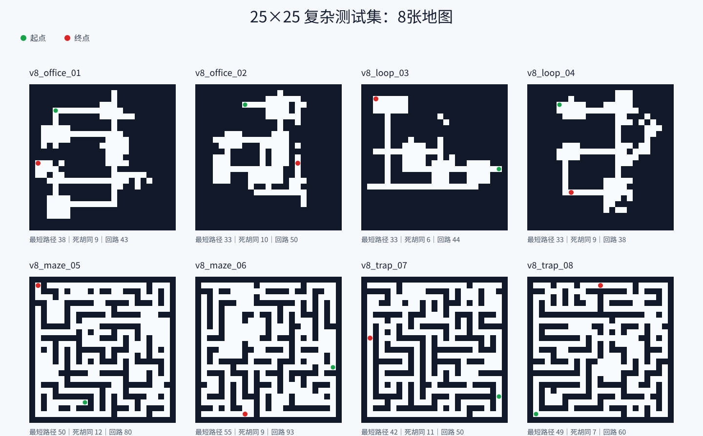
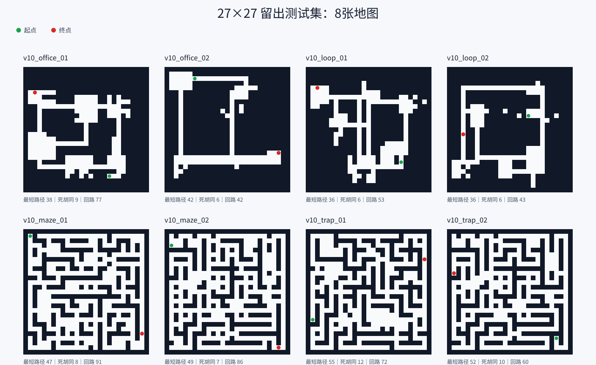
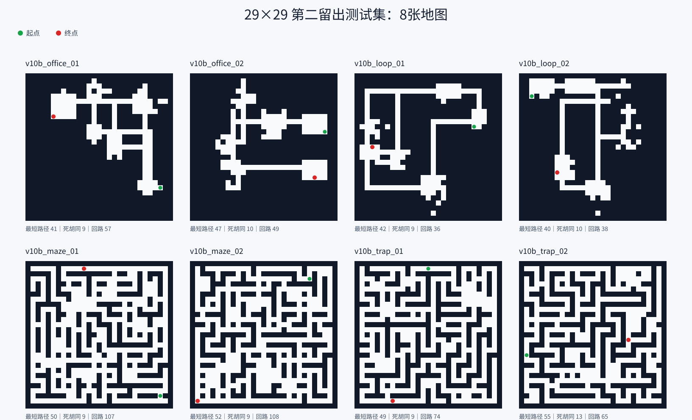

# MapGPT v10：精简实验报告

- 日期：2026-11-23
- 地图：21×21、25×25、27×27、29×29，每组8张
- 指标：成功率SR、路径效率SPL、未探索格预测正确率AP_UNSEEN

## 核心结论

最终方法：

**宏观分支 + 多分辨率地图预测 + 自适应观测 + 大图逐步重规划 + 结构化历史评分。**

100步进度与提升：

| 地图 | v6 SR | 之前最佳 SPL/AP | v10 SR | v10 SPL | v10 AP | ΔSR | ΔSPL | ΔAP |
|---|---:|---:|---:|---:|---:|---:|---:|---:|
| 21×21 | 1.000 | 0.982 / 0.652 | **1.000** | **0.982** | **0.652** | 0 | +0.3pp | +0.3pp |
| 25×25 | 0.500 | 0.881 / 0.681 | **1.000** | **0.949** | **0.720** | +50.0pp | +58.9pp | +3.1pp |
| 27×27 | 0.625 | 0.436 / — | **1.000** | **0.948** | **0.688** | +37.5pp | +51.2pp | — |
| 29×29 | 0.500 | 0.420 / — | 0.875 | **0.852** | 0.705 | +37.5pp | +43.2pp | — |

“Δ”统一相对v6 final；21和25的“之前最佳”为v9最佳配置，27和29在v10前没有对应AP结果。

主要结论：

- 25×25上SR、SPL和AP同时提升；
- 27×27上SR和SPL大幅提升；
- 29×29上SPL提升，AP基本持平；
- 最有效改进是宏观分支和大图逐步重规划；
- 最终几何导航不使用Qwen。

## 核心名词

| 名词 | 大白话解释 |
|---|---|
| **宏观分支** | 不把一个frontier小点孤立看待，而是把同一“岔路口+出口方向”的多个入口合并成一个大方向，减少反复横跳。 |
| **多分辨率地图预测** | 用同一套局部特征在多尺度的21×21、25×25地图上训练logistic预测器，为未知格输出墙体概率，从而适应不同大小地图。 |
| **自适应观测** | 不固定视野：小图5×5，大图默认7×7，处于岔路口或局部开阔处时使用9×9。 |
| **大图逐步重规划** | 大图每成功前进一格，就重新生成候选、重新评分并重跑A*，避免继续执行已经过时的整段路线。 |
| **结构化历史评分** | 不保存大段文本，而是保存每个分支的尝试、失败、信息收益、目标进展和禁用时间，并把这些数值加入航点分数。 |

## 实验地图与规模

每组主实验都使用相同的8张地图，所有条件在同一组地图上比较。

| 地图组 | 数量 | 用途 |
|---|---:|---|
| 21×21 | 8张测试图 | 原主实验；另有4张保留图用于早期调参 |
| 25×25 | 8张 | 复杂地图开发和消融 |
| 27×27 | 8张 | 第一次新地图验证 |
| 29×29 | 8张 | 固定最终方法后的第二次留出验证 |

四组合计32张评测地图。









## 最终流程

1. 机器人获得局部观测、当前位置和终点坐标。
2. 根据地图大小和当前地形选择下一帧观测窗口。
3. 在窗口内有遮挡地观察自由格、墙和未知区域。
4. 更新占用矩阵、稀疏拓扑和轨迹历史。
5. 地图预测器为所有未知格预测墙体概率。
6. 找frontier，并按“岔路口+出口方向”合并成宏观分支。
7. 用NMS删除距离过近的重复候选。
8. 根据路径、目标距离、风险、信息量和历史给航点打分。
9. 选择最佳航点；终点已发现时优先选择终点。
10. 用A*在已经确认自由的地图上规划到航点。
11. 执行转向或前进一格，并用新观测更新地图。
12. 大图每前进一格重新规划；小图到达当前航点后再规划。
13. 出现撞墙、振荡、重复边或无收益分支时执行保护。
14. 机器人坐标严格等于终点后执行STOP。

## 机制说明

### 观测窗口

- 5×5、7×7、9×9是最大观测窗口，不是完整真值；
- 窗口内从机器人位置做BFS，墙会遮挡后方；
- 21×21主要使用5×5；
- 大图默认7×7；
- 当前是已知岔路口，或局部通道代理判定为开阔时，下一帧使用9×9；
- 岔路口由拓扑邻居数≥3判断；
- 开阔代理为`max(左右自由邻居数,上下自由邻居数)+1≥3`；
- 这个开阔判断只是局部几何启发式，不是语义房间识别。

### 矩阵、拓扑和历史

- 矩阵记录已知墙、已知自由和未知格；
- 拓扑记录已确认可走的格子及其连通边；
- 历史记录轨迹、重复边、分支失败、信息收益和目标进展；
- 矩阵回答“附近长什么样”，拓扑回答“道路怎么连”，历史回答“以前走这里是否吃亏”。

### 航点、重规划和A*

- 航点是具体入口坐标，可能距离当前位置很多格；
- A*规划当前位置到航点的完整已知自由路线；
- 前进一格重规划不代表只向前看一格；
- 大图走一格后重新比较航点和路线，避免继续执行过时计划；
- 小图路线短，因此执行到当前航点后再规划。

### AP_UNSEEN

机器人会预测**所有未探索格**，不只是自己站过的格。

- 去过或已经看见的格子已知，不参与AP；
- 从未进入视野、仍未知的格子全部参与预测；
- 预测器输出每格墙概率，并用阈值转为墙/自由；
- 评测器使用隐藏真值比较预测结果；
- 每个决策点计算正确率，整个episode再平均；
- 机器人运行时不知道真值，AP只用于离线评价；
- 本项目AP是占用正确率，不是目标检测中的Average Precision。

## 算法与评分

实际使用：

- 多分辨率logistic墙概率预测；
- Dijkstra预测软距离，单格代价`1+7p`；
- frontier生成和宏观分支聚类；
- NMS距离4格；
- 每分支最多2个入口，全局最多6个候选；
- A*只在已知自由拓扑中规划；
- 大图每成功前进一格滚动重规划。

航点分数：

```text
score =
    1.20 × A*去程长度
  + 0.80 × 预计到终点距离
  + 2.60 × 风险
  - 0.30 × log(1+信息增益)
  - 0.20 × log(1+附近未知量)
  + 0.60 × 不确定性
  + 历史惩罚
  - 历史收益奖励
```

分数越低越优先。

风险近似：

```text
risk = 0.46 × 未知邻居比例
     + 0.32 × 窄通道风险
```

历史：

```text
惩罚 = 2×失败次数 + 0.25×后悔值
     + 禁用期内额外10

奖励 = min(3, 累计信息增益/5 + 正目标进展/3)
```

大图使用预测距离；小图更信任已观察图上的乐观A*距离。

## 实验结果与分析

### 80步紧预算

| 地图 | v6 SR/SPL | v10 final SR/SPL |
|---|---:|---:|
| 21×21 | 0.750 / 0.531 | **0.875 / 0.862** |
| 25×25 | 0.250 / 0.185 | **0.750 / 0.727** |
| 27×27 | 0.375 / 0.270 | **0.750 / 0.730** |
| 29×29 | 0.375 / 0.327 | **0.875 / 0.852** |

分析：预算越紧，方法收益越明显，说明主要减少了无效分支探索。

### 100/120步

| 地图，预算 | v6 SR/SPL | v10 final SR/SPL |
|---|---|---|
| 25×25，100 | 0.500 / 0.360 | **1.000 / 0.949** |
| 25×25，120 | 0.750 / 0.533 | **1.000 / 0.949** |
| 27×27，100 | 0.625 / 0.436 | **1.000 / 0.948** |
| 27×27，120 | 0.750 / 0.505 | **1.000 / 0.948** |
| 29×29，100 | 0.500 / 0.420 | **0.875 / 0.852** |
| 29×29，120 | 0.750 / 0.581 | **0.875 / 0.852** |

分析：100步后多数地图已完成，120步没有进一步收益。

### 关键试验结论

- 固定9×9可提高AP，但SPL不如几何自适应7/9；
- 几何自适应在25×25取得SPL `0.902`、AP `0.707`，固定9×9为`0.894/0.709`；
- 每1格重规划在25×25取得`0.949/0.720`；每4格只有`0.904/0.700`；
- 27×27每4格重规划出现失败，每1格恢复SR=1.000；
- 信息型、最深型和最近型航点均低于默认入口航点；
- 双预测器融合可小幅提高AP，但SPL不稳定，未作为默认；
- Qwen地图解析不稳定，导航中没有稳定收益，最终不使用；
- 29×29固定有一张trap地图失败，增加预算仍未解决。

## 防卡死

| 机制 | 触发条件 | 作用 |
|---|---|---|
| **逐步重规划** | 大图每成功前进一格 | 丢弃过时路线，重新选择航点 |
| 撞墙恢复 | 前进被墙阻挡 | 清空当前路线，重新规划 |
| 5帧振荡检测 | 连续A-B-A-B-A | 识别短周期来回移动 |
| 重复边保护 | 同一条无向边走过5次 | 降低继续重复同一路线的概率 |
| 分支失败禁用 | 无新信息且无目标进展 | 10步内强降权差分支 |
| 历史惩罚 | 分支以前失败或后悔值高 | 降低历史表现差的分支分数 |
| 窄通道风险 | 入口附近通道窄 | 提前提高该入口的风险项 |
| 严格STOP | 坐标完全等于终点 | 防止离终点很近时提前停止 |

结论：

- 这批确定性地图上，**逐步重规划是实际起作用的核心机制**；
- 撞墙、振荡、重复边和分支禁用多数没有触发，属于安全网；
- 旧候选抖动压力测试中，显式防卡死曾把SR从0.625提高到0.750、SPL从0.510提高到0.593；
- 地图熵奖励、持续回程惩罚、后悔回撤和固定预算门控没有稳定收益，已删除。

## 最终方法与限制

最终配置：

1. 21×21使用5×5观测和统一宏观/微观成本；
2. 25×25以上使用7×7/9×9自适应观测；
3. 大图只使用宏观分支；
4. 大图每成功前进一格重规划；
5. A*只走已知自由格；
6. 预测矩阵只提供软距离和风险；
7. 全程不调用LLM。

限制：

- 每组只有8张地图；
- 大图阈值24格和重规划频率仍需更多地图验证；
- 逐格重规划增加计算量；
- 开放区判断仍是几何代理；
- 29×29存在固定失败trap地图，AP也没有继续提升。

## 文件

- `figs/fig_maps_21.svg`：21×21测试地图；
- `figs/fig_maps_25.svg`：25×25测试地图；
- `figs/fig_maps_27.svg`：27×27留出地图；
- `figs/fig_maps_29.svg`：29×29留出地图；
- `data/aggregate.csv`：全部实验数值；
- `data/per_map_comparison.csv`：逐地图结果；
- `data/failure_cases.csv`：失败轨迹；
- `code/`：代码、地图、预测器和运行脚本；
- `data/raw_results_and_code.zip`：完整实验包。
