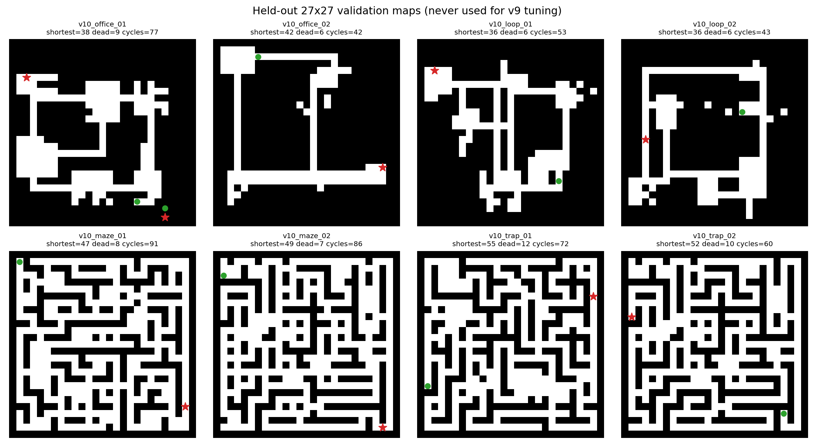
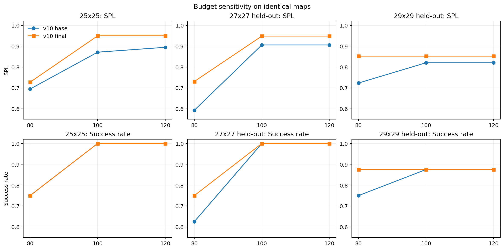

# MapGPT v10：自适应宏观规划与 AP–SPL 联合优化

- 日期：2026-11-23
- 实验：8×21×21、8×25×25、8×27×27、8×29×29 四套固定地图
- 对照：同一批地图、同一预算、同一预测器接口

## 结论先行

本轮保留的主方法不是新增 LLM，也不是继续叠加回撤规则，而是：

1. **宏观分支 + NMS=4**：按“首个岔路 + 出口方向”聚类 frontier；
2. **复杂度自适应抽象**：小图使用宏观/微观统一成本，大图只保留宏观分支；
3. **多分辨率地图预测**：预测占用矩阵转为带墙概率惩罚的软距离；
4. **几何自适应观测**：开放区/岔路口用 9×9，窄走廊用 7×7，小图保持 5×5；
5. **大图逐步滚动重规划**：每成功移动一格后重新评分，清除已经过时的整段路线假设；
6. **无 LLM 主控**：Qwen 在已有实验中格式不稳定、延迟高且没有稳定导航收益。

在 25×25 和两张新的留出大图上，最终方法相对同一预测器的保守基线：

| 地图 | 预算 | 基线 SPL | 最终 SPL | ΔSPL | 基线 AP | 最终 AP | ΔAP |
|---|---:|---:|---:|---:|---:|---:|---:|
| 25×25 | 100 | 0.894 | **0.949** | +5.5pp | 0.709 | **0.720** | +1.1pp |
| 27×27 留出 | 100 | 0.906 | **0.948** | +4.3pp | 0.679 | **0.688** | +0.9pp |
| 29×29 留出 | 100 | 0.820 | **0.852** | +3.1pp | **0.705** | 0.705 | ≈0 |

三张 100 步大图平均：**SPL +4.3 个点、AP +0.7 个点、联合分 +2.3 个点**，成功率保持 100%/100%/87.5%。

紧预算下提升更明显。相对旧 v6：

| 地图 | v6 SR | 最终 SR | v6 SPL | 最终 SPL |
|---|---:|---:|---:|---:|
| 25×25，80 | 0.250 | **0.750** | 0.185 | **0.727** |
| 27×27，80 | 0.375 | **0.750** | 0.270 | **0.730** |
| 29×29，80 | 0.375 | **0.875** | 0.327 | **0.852** |

重要限制：29×29 上 AP 没有提升，说明本轮并非在所有地图上都能保证 AP 与 SPL 同时增长。更准确的结论是：**地图预测与规划成本尺度一致时，可以在部分复杂地图上兼顾；单看 AP 不能保证 SPL。**



## 1. 指标与公平性

- **SR**：是否在预算内站到终点并执行 STOP；
- **SPL**：成功时 `最短路径 / max(实际路径, 最短路径)`，失败记 0；
- **AP_UNSEEN**：本项目实现的“未观察格占用预测正确率”，在每个决策点计算后对 episode 求平均。它不是目标检测中的 Average Precision；
- **JOINT**：`sqrt(SPL × AP_UNSEEN)`，只用于同时比较两个目标；
- 真实最短路径只用于最终计算 SPL，不参与决策；
- 终点坐标来自公开任务指令；未知区域的到终点距离由乐观 A* 或预测图软 Dijkstra 给出；
- 所有对照使用相同地图、相同步数预算、相同 STOP 判定和相同动作执行器。

## 2. 当前完整流程

```text
局部观测（5×5 / 7×7 / 9×9）
   ├─ 稠密占用概率矩阵 P[H,W]
   ├─ 稀疏文本拓扑：坐标 -> Place ID，四连通边
   └─ 轨迹历史：visited、重复边、距终点进展
                │
                ▼
多分辨率预测器补全未知区域
                │
每格代价 = 1 + 7 × P(墙)
                ▼
frontier 聚类 -> “岔路 + 出口方向”宏观分支 -> NMS=4
                │
                ▼
候选评分：去程成本 + 目标距离 + 风险 - 信息收益
                │
                ▼
已知图 A* 到具体入口格
                │
                ▼
底层转向/前进一步
                │
大图：每成功前进一格重新规划；小图：执行到航点后重规划
                │
                ▼
重复边/震荡/无信息分支触发否决；到终点坐标后 STOP
```

### 观测信息如何存储

- 稠密矩阵只保存当前机器人可见和曾经见过的占用状态，未知格由预测器补全；
- 文本拓扑保存已观察可走格及四连通边，不保存未经观测的真实地图；
- frontier 不单独长期保存，而是每轮由“已知自由格 + 未知邻居”重新生成；
- 轨迹保存访问序列、边访问次数和乐观目标距离变化，用于卡死检测。

这让矩阵负责连续几何，拓扑负责离散连通性，轨迹负责时间一致性。

## 3. 与最新工作的对应关系

| 论文 | 关键结论 | 本轮采用或验证 |
|---|---|---|
| Racing the Clock，arXiv:2611.17442 | 预算会改变 exploration 策略；房间/分支级抽象优于单纯贪心 frontier | 保留宏观分支；测试预算门控，但发现固定门控不泛化，未作为默认 |
| R2F，arXiv:2603.08475 | 方向条件 frontier + 经典建图规划，可完全不用 LLM | 保留“岔路 + 出口方向”分支，删除 LLM 主控 |
| GroundControl，arXiv:2606.20479 | 轨迹级进展、单调性、绕路和震荡比瞬时熵更能预测失败 | 保留重复边/震荡检测；静态地图熵和后悔值仍无效 |
| MOON，arXiv:2610.33546 | 偏离后需要判断何时清除错误历史 | 大图逐步重规划作为“清除过时路线”的确定性近似 |
| What Should a Navigator Remember?，arXiv:2610.38318 | 任务、时间和空间记忆应结构化保存 | 使用矩阵 + 拓扑 + 轨迹三部分，而不是把全部历史塞给 LLM |
| Structure over Reasoning，arXiv:2610.25130 | 小 VLM 更适合给感知证据，几何控制器负责路线 | Qwen 只适合未来语义歧义；当前几何任务不调用 |
| OpenSpace Lab，IROS 2026，arXiv:2610.01505 | 预训练地图补全、全局规划、剩余时间约束和 homing 约束 | 多分辨率预测 + 软距离 + 滚动重规划；预算硬门控验证失败 |
| InsightMap，arXiv:2609.37187 | 动作后的地图预测可作为有用监督 | 支持“预测服务规划”，但本轮没有训练大型动作条件模型 |
| dPWM，ICRA 2026，DOI:10.1109/ICRA57385.2026.11696058 | 扩散地图补全 + 全局规划 | 受数据和算力限制，本轮验证轻量预测软距离，不声称复现扩散模型 |

## 4. 机制消融

25×25、100 步、同一批 8 张地图：

| 方法 | SR | SPL | AP | 判断 |
|---|---:|---:|---:|---|
| 宏观基线，7×7 | 1.000 | 0.871 | 0.697 | 保留 |
| 纯乐观距离，不用预测距离 | 1.000 | 0.859 | 0.694 | 预测软距离有小幅正收益 |
| 预测距离权重 0.5 | 1.000 | 0.881 | 0.693 | SPL 好，但 AP 下降 |
| 固定 9×9 | 1.000 | 0.894 | **0.709** | AP 高，路径效率仍不足 |
| 几何自适应 7/9 | 1.000 | **0.902** | 0.707 | 保留 |
| 每 4 步重规划 | 1.000 | 0.904 | 0.700 | 有收益但不稳健 |
| 几何观测 + 每 2 步重规划 | 1.000 | 0.936 | 0.719 | 保留为备选 |
| **几何观测 + 每 1 步重规划** | **1.000** | **0.949** | **0.720** | 主方法 |
| 再融合双预测器 | 1.000 | 0.946 | **0.724** | AP 略高，SPL 低，未设为默认 |
| 信息型代表航点 | 1.000 | 0.799 | 0.698 | 负收益，删除 |
| 最深代表航点 | 0.875 | 0.648 | 0.696 | 负收益，删除 |
| 最近代表航点 | 1.000 | 0.853 | 0.701 | 负收益，删除 |

滚动重规划的收益并非简单来自“更频繁”：

- 每 4 步重规划在 27×27、100 步留出集上出现 1 次失败；
- 每 1 步重规划在 27×27 恢复为 100%；
- 每 4 步在 29×29 的 SPL 反而降至 0.834，低于主方法的 0.852。

原因是大图分支代价变化快，固定 4 步会让整段过时路线继续执行；逐格重规划虽然计算更贵，但重新评分最及时。


## 5. 主结果

### 100 步：与旧方法和匹配基线比较

| 地图 | 方法 | SR | SPL | AP |
|---|---|---:|---:|---:|
| 21×21 | v6 final | 1.000 | 0.709 | 0.649 |
| 21×21 | v9/v10 最终 | **1.000** | **0.982** | **0.652** |
| 25×25 | v6 final | 0.500 | 0.360 | 0.689 |
| 25×25 | 保守宏观基线 9×9 | 1.000 | 0.894 | 0.709 |
| 25×25 | **v10 final** | **1.000** | **0.949** | **0.720** |
| 27×27 | v6 final | 0.625 | 0.436 | 不记录 |
| 27×27 | 保守宏观基线 9×9 | **1.000** | 0.906 | 0.679 |
| 27×27 | **v10 final** | **1.000** | **0.948** | **0.688** |
| 29×29 | v6 final | 0.500 | 0.420 | 不记录 |
| 29×29 | 保守宏观基线 9×9 | 0.875 | 0.820 | **0.705** |
| 29×29 | **v10 final** | **0.875** | **0.852** | 0.705 |


### 预算变化

| 地图与预算 | 基线 SR/SPL/AP | 最终 SR/SPL/AP |
|---|---|---|
| 21×21，80 | 0.750 / 0.531 / 0.645 | **0.875 / 0.862 / 0.654** |
| 21×21，100 | 1.000 / 0.982 / 0.652 | 1.000 / 0.982 / 0.652 |
| 25×25，80 | 0.750 / 0.694 / 0.706 | 0.750 / **0.727 / 0.719** |
| 25×25，100 | 1.000 / 0.894 / 0.709 | 1.000 / **0.949 / 0.720** |
| 25×25，120 | 1.000 / 0.894 / 0.709 | 1.000 / **0.949 / 0.720** |
| 27×27，80 | 0.625 / 0.592 / 0.677 | **0.750 / 0.730 / 0.685** |
| 27×27，100 | 1.000 / 0.906 / 0.679 | 1.000 / **0.948 / 0.688** |
| 29×29，80 | 0.750 / 0.723 / 0.704 | **0.875 / 0.852 / 0.704** |
| 29×29，100 | 0.875 / 0.820 / 0.705 | 0.875 / **0.852 / 0.705** |



配对 bootstrap 的 95% SPL 区间：

- 25×25：`+7.83pp [1.78, 13.88]`，5 胜、2 平、1 负；
- 27×27：`+4.25pp [-0.34, 9.41]`，4 胜、3 平、1 负；
- 29×29：`+3.14pp [1.19, 5.14]`，5 胜、3 平、0 负。

8 张地图仍属于小样本，27×27 的区间跨 0，应视为方向性证据而不是显著性结论。

## 6. AP 是否提高、是否影响导航

### 6.1 多分辨率预测器

固定快照上：

| 预测器 | 21 AP | 21 平衡准确率 | 25 AP | 25 平衡准确率 |
|---|---:|---:|---:|---:|
| 原 logistic | 0.611 | 0.711 | 0.667 | 0.708 |
| 多分辨率 logistic | **0.631** | **0.808** | **0.668** | **0.749** |

多分辨率训练明显提高平衡准确率，是最终默认预测器。

### 6.2 双预测器融合

原模型 + 多分辨率模型的加权融合，在 25×25 快照上把 AP 从 0.668 提到 0.674。

导航结果：

- 25×25：融合后 AP 从 0.720 到 0.724，SPL 从 0.949 降到 0.946；
- 27×27：融合后 AP 从 0.688 到 0.691，SPL 从 0.948 降到 0.930。

因此双预测器融合只作为可选 AP 提升方案，不作为默认。它证明“预测更准”与“路线更短”之间没有自动传导关系。

### 6.3 AP 与卡死

最终方法各 episode 中：

- AP–SPL 相关系数约 0.42–0.46；
- AP–覆盖率相关系数约 0.81–0.90。

AP 提升更直接反映“看了多少并能正确补全”，弱于反映“历史路线是否已经低效”。真正改善导航的是：

- 地图软代价与候选路径成本使用同一尺度；
- 逐格重规划及时改写路线；
- 几何观测减少窄走廊中的无效大视野。

## 7. 防卡死与失败原因

最终方法在所有 100/120 步 25×25 和 27×27 地图上均为 SR=1；29×29 只有 `trap_02` 在 100/120 步仍失败。

80 步失败不是撞墙或短周期打转：

- 25×25 两个失败 episode：撞墙 0，重复边最多 2 次，终点距离为 3 和 5；
- 27×27 两个失败 episode：撞墙 0，无立即回退，终点距离为 2 和 10；
- 29×29 唯一失败：撞墙 0，最大重复边 2 次，仍在探索远端区域。

更准确的失败定义是：**预算耗尽前已经探索了部分长分支，但尚未形成到终点的可达路线**。这属于长时探索预算问题，不是原地死锁。

保留的安全机制：

- 真实撞墙后清空路线；
- 5 帧振荡检测；
- 单边重复超过阈值时重新选择；
- 分支无信息且无目标进展时短期否决；
- 只在机器人坐标等于终点时 STOP。

删除的安全机制：

- 地图熵直接加权；
- 回程预算持续惩罚；
- 后悔值回撤；
- 固定预算后期目标硬门控。

目标硬门控在 25×25 上把 SPL 从 0.949 提到 0.953，但在 27×27 降到 0.945、29×29 降到 0.835，并且仍未解决 29×29 的失败，因此不能作为通用方法。

## 8. 有效与无效方法清单

### 明确保留

| 方法 | 证据 |
|---|---|
| 宏观分支及 NMS=4 | 21×21 和 25×25 均明显优于微观 frontier |
| 大图只用宏观分支、小图统一成本 | 避免大图上微观候选干扰 |
| 多分辨率预测器 | AP 和平衡准确率稳定提高 |
| 几何自适应观测 | 25×25 SPL/AP 同升 |
| 大图每格滚动重规划 | 25/27/29 主结果提升且 4 步版本有反例 |
| 坐标 STOP 门 | 无提前停止和撞墙 |

### 删除或降级

| 方法 | 结果 |
|---|---|
| Qwen 主控/高频调用 | 历史上无稳定收益；Plus/Max 地图格式解析率仅 62.5%/58.3% |
| 信息型、最深、最近代表航点 | SPL 或 SR 下降 |
| 地图熵直接作为探索奖励 | 中性或负收益 |
| 回程预算持续惩罚 | 中性或负收益 |
| 后悔值回撤 | 触发恢复但没有提高 SPL |
| 固定预算门控 | 只在 25×25 有效，留出图下降 |
| 双预测器融合作为默认 | AP 小升，SPL 不稳定 |
| 固定 4 步重规划 | 27×27 出现失败，29×29 低于逐步版本 |

## 9. 创新点与论文表述边界

较有实验支持、可以继续打磨的创新点是：

1. **面向宏观分支的滚动规划**：把“选一个 frontier 并执行到底”改为每格重新比较宏观出口，直接降低长回路的沉没成本；
2. **观察视野随局部几何变化**：窄走廊保持中等视野，开放区和岔路口扩大观测，既不固定 5×5，也不盲目全局 9×9；
3. **复杂度条件抽象**：地图规模和预算共同决定宏观/混合候选与重规划频率；
4. **预测地图—规划代价一致性**：预测概率直接转成同一单位下的软路径距离，而不是把 AP 当奖励项；
5. **LLM-free 的结构化零样本导航**：矩阵、拓扑、轨迹分工，Qwen 保留给未来语义歧义。

A*、frontier、拓扑–度量地图本身都不是新算法。论文中应把创新定位为“分层表示与执行策略的组合和实证”，不能声称这些基础组件首次提出。

## 10. 局限与下一步

本轮没有训练强化学习策略。当前数据只有每套 8 张固定地图，直接训练 RL 容易把评测地图记忆成策略；因此本轮先采用可解释的零样本滚动规划。

优先后续：

1. **更多留出地图**：至少 50–100 张 25–35 格地图，冻结参数后只测一次；
2. **学习式重规划触发器**：用进展斜率、绕路率、剩余预算预测“下一步重规划是否值得”，减少每格 A* 计算；
3. **双头地图预测**：一个头优化占用 AP，一个头优化规划距离/可通行代价，并加入动作条件监督；
4. **真正预算条件策略**：训练房间级或门级 Bellman/RL 策略，而不是手工后期门控；
5. **语义歧义实验**：加入房间名、物体描述和错误指令，只在候选近乎同分时调用 Qwen；
6. **动态障碍与执行噪声**：测试移动障碍、定位噪声和动作失败，验证滚动规划是否比固定航点更稳；
7. **计算成本**：测量每格 A* 重规划的 CPU 时间，并与每 2/4 步版本比较真实部署吞吐。

## 11. 复现文件

- `code/mapgpt_v7.py`：最终代码；
- `code/run_v10_final.sh`：最终方法入口；
- `code/benchmark_maps_v10.py/json`：27×27 留出集；
- `code/benchmark_maps_v10b.py/json`：29×29 留出集；
- `data/aggregate.csv`：所有条件汇总；
- `data/aggregate.json`：最终对比和逐项指标；
- `data/per_map_comparison.csv`：逐地图配对结果；
- `data/failure_cases.csv`：失败轨迹诊断；
- `figs/`：报告图表；
- `data/raw_results_and_code.zip`：代码、地图、结果和报告打包。
