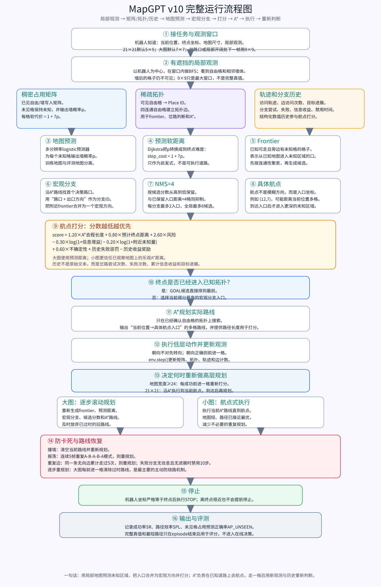

# MapGPT v10：精简实验报告

- 日期：2026-11-23
- 实验：21×21、25×25、27×27、29×29 四套地图，每组 8 张
- 目标：同时提高成功率 SR、路径效率 SPL 和未观察区域预测精度 AP

## 1. 结论

最终方法为：

**宏观分支 + 多分辨率地图预测 + 几何自适应 7×7/9×9 观测 + 大图逐步滚动重规划 + 结构化历史评分。**

100 步下，三套大型地图平均：

- 同预测器内部增量：25×25约 **SPL+5.5/AP+1.1个点**，27×27约 **SPL+4.3/AP+0.9个点**；29×29约 **SPL+3.1个点、AP持平**；
- 相对旧 v6：成功率平均提高约 **42 个点**，SPL 平均提高约 **51 个点**；
- 25×25 和27×27上 AP、SPL 同时提高；
- 29×29上 SPL 提高，AP 持平，因此不能声称所有地图都能同时提升两项指标。

最终保留：

- 宏观分支；
- NMS=4；
- 多分辨率预测器；
- 大图逐步重规划；
- 几何自适应观测；
- 结构化分支与轨迹历史；
- 坐标 STOP 和重复边/振荡保护。

最终删除：

- Qwen 主控；
- 地图熵直接奖励；
- 持续回程预算惩罚；
- 后悔回撤；
- 信息型、最深、最近代表航点；
- 固定预算门控；
- 双预测器融合作为默认配置；
- 固定每4步重规划。

## 2. 完整流程



流程图的文字版摘要：

1. 取得终点坐标和局部有遮挡观测；
2. 更新占用矩阵、稀疏拓扑和轨迹历史；
3. 预测未知格墙体，生成软距离；
4. 找frontier，合并成宏观分支并用NMS过滤；
5. 根据路径、目标距离、风险、信息量和历史分数选择航点；
6. A*只在已知自由格上规划路线；
7. 执行一个低层动作并更新地图；
8. 大图每成功前进一格重新规划；
9. 防卡死检查；
10. 机器人真正站到终点后执行STOP。

### 观测窗口规则

- 机器人只看到以自身为中心、受墙体遮挡的局部窗口；
- 大图默认7×7；
- 已知拓扑度数≥3，即岔路口，使用9×9；
- 局部可通过性代理 `max(左右自由数, 上下自由数)+1≥3`，使用9×9；
- 上述“开放区”只是局部几何启发式，不是语义房间识别；
- 最终实验使用5×5、7×7、9×9，不使用8×8。

## 3. 大白话概念解释

### 3.1 机器人到底知道什么

机器人知道自己的位置和朝向，知道终点坐标和地图大小，也能看到身边一小块区域。

它不知道完整户型、墙在哪里、哪条路一定能到终点，也不知道最短路径。报告里的完整彩色地图是给人和评测器看的，不是机器人拿到的输入。

### 3.2 5×5、7×7、9×9 是什么

这是机器人一次能看多大范围的最大窗口，不是机器人能直接得到整个正方形的真值。

例如7×7窗口，是机器人周围横向7格、纵向7格的边框；程序会从这个窗口内的机器人位置开始做BFS。自由格可以看穿，墙会挡住后面，所以实际看到的是不规则区域。

窗口决定的是“下一帧观测用多大范围”：

- 21×21实验中主要用5×5；
- 25×25以上默认用7×7；
- 如果当前机器人站在已知岔路口，或局部判定为开阔/直通道，则下一帧改用9×9；
- 三项条件都不满足时用7×7。

当前“开阔”判断是几何代理：

```text
max(左右两个方向是否自由的和, 上下两个方向是否自由的和)+1 ≥ 3
```

已知拓扑邻居数≥3则直接认为在岔路口。这个判断不是语义模型，也不是真正测量房间大小，所以报告把它写成“局部几何启发式”。

### 3.3 矩阵、拓扑和历史分别是什么

- **占用矩阵**：把已知自由、已知墙和未知格画成二维网格；未知格的墙概率由预测器补全；
- **拓扑**：只记录已经看见并可走的格子，以及它们之间的四连通边；
- **历史**：记录机器人走过哪里、每条边走了几次、每个岔路以前是否失败、分支带来过多少新格子、是否靠近过终点。

所以矩阵回答“附近长什么样”，拓扑回答“已知道路怎么连”，历史回答“以前走这里有没有吃亏”。

### 3.4 航点和 A* 是什么关系

航点是一个具体入口坐标，例如 `(12,7)`，不是“大概向右”这种模糊方向。候选可能距离当前位置很多格。

A*负责在当前已知自由格上找到：

```text
当前位置 → 航点入口
```

这条路线可能包含很多格。机器人按路线每次转向或前进一格。实际还没确认的预测区域不会直接被A*当成可走道路。

### 3.5 为什么大图每走一格就重新规划

大图一次规划出来的路线会比较长，走几步后新观测可能表明前方是死路，或者另一个出口更接近终点。如果继续机械执行原路线，就会产生沉没成本。

因此大图每成功前进一格后：

```text
看新地图 → 重新预测 → 重新生成候选 → 重新打分 → 重新A*
```

这叫滚动重规划。小图路线短且已经接近最优，因此执行到当前航点后再规划。

注意“每走一格重规划”不是只向前看一格，也不是只选择一个相邻格。它仍然会先选择远处航点并运行A*，只是每前进一格就检查原来的航点是否还值得去。

### 3.6 AP_UNSEEN 到底怎么算

机器人不会只预测“自己站过的格子”。程序会对当前地图中所有**未探索格**输出一个墙概率：

- 站过的格子在 `explored_cells` 中；
- 没站过但已经看见的格子也在 `explored_cells` 中；
- 只有从没进入局部视野、状态仍未知的格子才进入 `unknown_mask`；
- 这些未知格都会由预测器输出概率，并全部参与 AP 计算。

评测时，仿真器知道每个未知格真实是墙还是自由。程序比较：

```text
预测墙 = (预测概率 ≥ 阈值)
正确   = 预测墙 与 真实墙 相同
AP_UNSEEN = 所有未知格中预测正确的比例
```

每个决策点算一次，整个episode再取平均。

机器人运行时不知道预测对不对；完整真值只在决策完成后供评测器算分。因此AP是离线评价指标，不能直接当作在线导航输入。

### 3.7 实际使用的算法

| 模块 | 算法 | 作用 |
|---|---|---|
| 墙体补全 | 多分辨率 logistic 分类器 | 为所有未知格预测墙概率 |
| 预测距离 | Dijkstra软代价 | 从终点向全图传播，边代价 `1+7p` |
| Frontier生成 | 已知自由格 + 未知邻居检查 | 找从已知区域进入未知区域的边界 |
| 宏观分支 | 基于A*路线、拓扑度数、出口方向聚类 | 把多个近邻frontier合并成一个宏观方向 |
| 候选去重 | 曼哈顿NMS | 防止相邻候选重复 |
| 实际路线 | A* | 只在已知自由拓扑中规划到具体航点 |
| 执行 | 转向 + 单格前进 | A*路线被逐格执行 |
| 重规划 | Receding-horizon planning | 大图每前进一格重新选择航点并重跑A* |

### 3.8 航点评分与具体参数

```text
score =
    1.20 × A*去程路径长度
  + 0.80 × 预计到终点距离
  + 2.60 × 局部风险
  - 0.30 × log(1 + 信息增益)
  - 0.20 × log(1 + 附近未知格数)
  + 0.60 × 区域不确定性
  + 历史惩罚
  - 历史收益奖励
```

分数越低越优先。

| 参数 | 取值 | 含义 |
|---|---:|---|
| NMS距离 | 4格 | 距离已保留入口小于4格则删除 |
| 每分支入口上限 | 2 | 防止同一分支重复占满候选 |
| 全局候选上限 | 6 | 一次最多比较6个候选 |
| 预测图单格步长代价 | `1+7p` | p越大，越不愿意穿过该格 |
| 风险中的未知邻居权重 | 0.46 | 越靠近大量未知区域风险越高 |
| 风险中的窄通道权重 | 0.32 | 通道代理宽度≤2时加风险 |

局部风险近似为：

```text
risk = 0.46 × (未知邻居数/4) + 0.32 × (通道宽度≤2)
```

历史项：

```text
历史惩罚 = 2×失败次数 + 0.25×后悔值
           + 若分支仍在禁用期，再加10

历史奖励 = min(3,
             累计信息增益/5
           + max(累计目标进展,0)/3)
```

- 大图最终配置使用预测软距离作为终点距离；
- 小图最终配置更信任已观察图上的乐观A*距离；
- 小图统一成本版本还会检查回程预算，并额外加入0.8×不确定性；
- 回程预算和额外不确定性在普通测试中只有中性效果，保留是为了兼容小图既有配置。

## 4. 指标与公平性

- SR：预算内到达终点并执行 STOP；
- SPL：`最短路径 / max(实际路径, 最短路径)`，失败记0；
- AP_UNSEEN：对每个决策点，将未知格的预测墙体与隐藏真值比较，计算二元占用正确率；episode内平均；
- JOINT：`sqrt(SPL × AP_UNSEEN)`；
- 真实完整地图和最短路径只用于仿真碰撞与离线评分，不进入航点决策；
- 每条实验条件使用完全相同的8张地图和相同预算。

说明：AP_UNSEEN 是本项目指标，不等同于目标检测中的 Average Precision。


## 5. 主要结果

### 5.1 100步主结果

| 地图 | 方法 | SR | SPL | AP_UNSEEN |
|---|---|---:|---:|---:|
| 21×21 | v6 final | **1.000** | 0.709 | 0.649 |
| 21×21 | v10 final | **1.000** | **0.982** | **0.652** |
| 25×25 | v6 final | 0.500 | 0.360 | 0.689 |
| 25×25 | v10 final | **1.000** | **0.949** | **0.720** |
| 27×27 | v6 final | 0.625 | 0.436 | 不记录 |
| 27×27 | v10 final | **1.000** | **0.948** | **0.688** |
| 29×29 | v6 final | 0.500 | 0.420 | 不记录 |
| 29×29 | v10 final | 0.875 | **0.852** | 0.705 |

分析：

1. 21×21已经接近饱和，最终方法与v9最优结果相同；
2. 25×25相对v6同时提高SR、SPL和AP；
3. 27×27和29×29显著提高SR与SPL，旧v6未记录可用于比较的AP；
4. 同预测器内部消融显示：25×25和27×27上SPL与AP可以同时提高；29×29上AP基本持平；
5. 旧v6的主要问题是长分支探索过多，宏观分支和滚动重规划直接解决了这一部分。

### 5.2 预算敏感性

80步重点是验证相对旧v6的改进：

| 地图，80步 | v6 SR/SPL | v10 final SR/SPL |
|---|---:|---:|
| 21×21 | 0.750 / 0.531 | **0.875 / 0.862** |
| 25×25 | 0.250 / 0.185 | **0.750 / 0.727** |
| 27×27 | 0.375 / 0.270 | **0.750 / 0.730** |
| 29×29 | 0.375 / 0.327 | **0.875 / 0.852** |

100/120步继续与v6比较：

| 地图，预算 | v6 SR/SPL | 最终 SR/SPL |
|---|---|---|
| 25×25，100 | 0.500 / 0.360 | **1.000 / 0.949** |
| 25×25，120 | 0.750 / 0.533 | **1.000 / 0.949** |
| 27×27，100 | 0.625 / 0.436 | **1.000 / 0.948** |
| 27×27，120 | 0.750 / 0.505 | **1.000 / 0.948** |
| 29×29，100 | 0.500 / 0.420 | **0.875 / 0.852** |
| 29×29，120 | 0.750 / 0.581 | **0.875 / 0.852** |

分析：

- 收益在80步紧预算下最大，说明方法主要减少无效探索；
- 100步后多数地图已到达终点，120步没有进一步收益；
- 29×29始终有1张traps地图失败，增加预算也没有解决，说明该失败不是单纯时间不足。

## 6. 全部消融实验分析

### 6.1 观测窗口与开放区策略

25×25，100步：

| 观测策略 | SR | SPL | AP | 结论 |
|---|---:|---:|---:|---|
| 固定5×5 | 1.000 | 0.775 | 0.683 | 视野不足 |
| 固定7×7 | 1.000 | 0.871 | 0.697 | 基础方案 |
| 固定9×9 | 1.000 | 0.894 | 0.709 | AP高，但计算与路径不是最优 |
| 分阶段放大 | 1.000 | 0.865 | 0.696 | 负收益 |
| 停滞时放大 | 1.000 | 0.871 | 0.697 | 中性 |
| **几何自适应7/9** | **1.000** | **0.902** | **0.707** | 保留 |
| 小图几何自适应 | 1.000 | 0.982 | 0.652 | 与固定5×5相同 |

分析：固定大视野能提高AP，但不保证SPL；按局部几何切换视野是更好的折中。

### 6.2 重规划频率

25×25，100步：

| 重规划间隔 | SR | SPL | AP |
|---|---:|---:|---:|
| 每1次前进 | **1.000** | **0.949** | **0.720** |
| 每2次前进 | 1.000 | 0.936 | 0.719 |
| 每3次前进 | 1.000 | 0.925 | 0.719 |
| 每4次前进 | 1.000 | 0.904 | 0.700 |
| 每6次前进 | 1.000 | 0.868 | 0.696 |
| 每8次前进 | 1.000 | 0.871 | 0.697 |
| 每12次前进 | 1.000 | 0.871 | 0.697 |

27×27上，每4步版本出现1次失败；每1步版本恢复SR=1.000，SPL=0.948。

分析：长分支中局部新观测会快速改变最优出口，旧路线继续执行的沉没成本很高。逐格重规划的代价是A*调用次数增加。

### 6.3 航点代表方式

25×25，100步：

| 航点选择 | SR | SPL | AP |
|---|---:|---:|---:|
| 默认分支入口 | **1.000** | **0.871** | 0.697 |
| 信息量最大格 | 1.000 | 0.799 | 0.698 |
| 路径最深格 | 0.875 | 0.648 | 0.696 |
| 最近入口 | 1.000 | 0.853 | 0.701 |

21×21也呈相同趋势：信息型0.917、最深型0.840、最近型0.848，均低于默认0.982。

分析：把航点推到更远或更高信息位置会增加错误分支的承诺成本；“具体入口格”最稳。

### 6.4 预测距离与模型融合

25×25，100步，固定7×7：

| 终点距离/预测器 | SR | SPL | AP |
|---|---:|---:|---:|
| 纯乐观已知图距离 | 1.000 | 0.859 | 0.694 |
| 预测/乐观各50% | 1.000 | 0.881 | 0.693 |
| 纯预测软距离 | **1.000** | **0.871** | **0.697** |
| 双预测器融合权重0.25 | 1.000 | 0.871 | 0.696 |
| 双预测器融合权重0.50 | 1.000 | 0.871 | **0.700** |
| 双预测器融合权重0.75 | 1.000 | 0.871 | 0.693 |

21×21上增加预测距离权重会把SR从1.000降到0.875，说明小图不应过度信任地图补全。

双预测器融合与逐步重规划组合后：

- 25×25：SPL从0.949降到0.946，AP从0.720升到0.724；
- 27×27：SPL从0.948降到0.930，AP从0.688升到0.691。

分析：融合能小幅提高AP，但不能稳定提高SPL，因此不作为默认。

### 6.5 宏观粒度与NMS

21×21，100步：

| 粒度 | SPL | 结论 |
|---|---:|---|
| NMS=2 | 0.965 | 候选重复 |
| **NMS=4** | **0.982** | 保留 |
| NMS=6 | 0.949 | 分支过少 |
| 每分支仅1候选 | 0.982 | 无额外影响 |
| Top-k=4 | 0.982 | 无额外影响 |

NMS=4表示：候选入口与已保留入口的曼哈顿距离小于4时被抑制，最终候选空间间隔至少4格。


### 6.6 预算门控与“锁定终点后扩视野”

| 方法 | 25×25 | 27×27 | 29×29 | 结论 |
|---|---:|---:|---:|---|
| 最终方法 | 0.949 / 0.720 | 0.948 / 0.688 | 0.852 / 0.705 | 稳定 |
| 预算门控，倍率2 | **0.953 / 0.722** | 0.945 / 0.687 | 0.835 / 0.710 | 只在小图有效 |
| 锁定终点后9×9 | 0.946 / 0.719 | 0.948 / 0.688 | 未提升 | 收益有限 |

分析：手工预算门控和终点后扩视野都只产生局部收益，不能跨地图复现。

### 6.7 地图预测器

固定快照测试：

| 预测器 | 21 AP | 21平衡准确率 | 25 AP | 25平衡准确率 |
|---|---:|---:|---:|---:|
| 原logistic | 0.611 | 0.711 | 0.667 | 0.708 |
| **多分辨率logistic** | **0.631** | **0.808** | **0.668** | **0.749** |
| 结构距离先验 | 0.619 | 0.668 | 0.555 | 0.642 |

分析：

- 多分辨率训练提高了平衡准确率，是默认预测器；
- AP提高不自动带来SPL提高；
- 最终方法各episode中AP–SPL相关约0.42–0.46，AP–覆盖率相关约0.81–0.90；
- AP更反映“补全了多少可解释结构”，轨迹进展才更直接反映卡死风险。

### 6.8 Qwen与强化学习

- qwen-plus地图解析率62.5%，qwen-max为58.3%；
- LLM预测AP未超过非LLM结构预测器；
- 宏观候选近平局时调用LLM，在普通宏观方法上只增加约0.6个SPL点，在统一成本方法中没有稳定收益；
- 最终几何任务不调用LLM；
- 本轮没有训练RL。原因是没有足够多的独立训练地图，直接在8张评测图上训练容易产生记忆和泄漏。

## 7. 防卡死与失败分析

最终方法在25×25、27×27的100/120步均为SR=1.000。29×29仍有一个固定失败地图。

| 场景 | 失败数 | 特征 | 原因 |
|---|---:|---|---|
| 25×25，80 | 2/8 | 撞墙0，终点距离3和5 | 预算耗尽前差最后几步 |
| 27×27，80 | 2/8 | 撞墙0，终点距离2和10 | 长分支探索占用过多 |
| 29×29，80 | 1/8 | 终点距离16 | 探索远端后未及回程 |
| 29×29，100/120 | 1/8 | 同一trap地图，距离17 | 分支选择问题，不是原地打转 |

### 7.1 各种防卡死机制及实际状态

| 机制 | 何时触发 | 最终大图是否启用 | 实际作用 |
|---|---|---|---|
| **逐步滚动重规划** | 大图每成功前进一格 | 是 | **最主要、明确有效**；及时丢弃过时路线 |
| 撞墙恢复 | 执行前进但被墙阻挡 | 是 | 清空当前路线；最终成功地图撞墙0次，属于安全网 |
| 5帧振荡检测 | 轨迹连续出现A-B-A-B-A | 小图启用；大图最终macro模式未启用 | 最终主实验未触发，避免短周期来回走 |
| 重复边保护 | 同一条无向边累计走过5次 | 小图启用；大图最终macro模式未启用 | 最终失败轨迹最大边重复仅1–2次，未触发 |
| 分支失败禁用 | 到达分支入口后无新信息且无目标进展 | 是 | 失败次数+1，分支10步内强降权；最终成功地图恢复计数为0 |
| 结构化历史惩罚 | 分支以前失败或后悔值较高 | 是 | 持续降低差分支优先级 |
| 严格STOP门 | 机器人坐标完全等于终点 | 是 | 防止“离终点很近就误停” |
| 窄通道风险项 | 候选入口通道较窄 | 是 | 打分阶段降低高风险入口 |

大图最终方案真正改变路线的核心是**逐步重规划**。撞墙、振荡、重复边和失败分支禁用属于部署安全网，在这批确定性测试中大多没有触发，因此不能夸大成主要增益来源。

旧v6的“候选排序抖动”压力测试中，显式防卡死曾把SR从0.625提高到0.750、SPL从0.510提高到0.593，说明在候选不稳定时仍有价值；但普通确定性地图很少触发这些分支。

### 7.2 已删除的防卡死/预算策略

- 地图熵直接奖励：中性或负收益；
- 持续回程预算惩罚：没有稳定提高SR；
- 后悔值回撤：旧实验触发9次，但没有提高SPL；
- 固定预算门控：25×25略升，27/29×29下降；
- 固定每4步重规划：27×27出现失败，不如逐步重规划稳定。

## 8. 最终方法与限制

最终方法：

1. 21×21使用5×5观测、宏观/微观统一成本，到达航点后重规划；
2. 25×25以上使用7×7/9×9自适应观测、只用宏观分支；
3. 25×25以上每成功前进一格重新评分；
4. 航点分数由已知A*路径、预测终点距离、风险、信息量、不确定性和结构化历史组成；
5. A*只规划已确认自由格，预测矩阵只提供软距离和风险；
6. 全程不使用LLM主控。

主要限制：

- 每组只有8张地图；
- 大图阈值“地图宽度≥24格”和重规划频率来自这组实验，仍需更多地图验证；
- 逐格重规划增加计算开销，本轮没有优化CPU时间；
- 开放区判定是局部几何代理，不是语义房间识别；
- 29×29已出现AP不再提升和固定trap失败案例。

## 9. 实验文件

- `figs/fig0_pipeline.svg`：完整运行流程图；
- `figs/fig1_maps_v10.png`：27×27留出地图；
- `figs/fig3_ablation.png`：模块消融；
- `data/aggregate.csv`：全部实验条件；
- `data/aggregate.json`：总体与最终对比；
- `data/per_map_comparison.csv`：逐地图配对结果；
- `data/failure_cases.csv`：失败轨迹指标；
- `code/`：最终代码、地图、预测器和运行脚本。

设计参考：R2F的无LLM方向frontier、GroundControl的轨迹失败信号、MOON的历史清除、Racing the Clock的预算/房间抽象、OpenSpace的预测地图全局规划。本轮只保留能在同一地图上产生可复现收益的部分。
