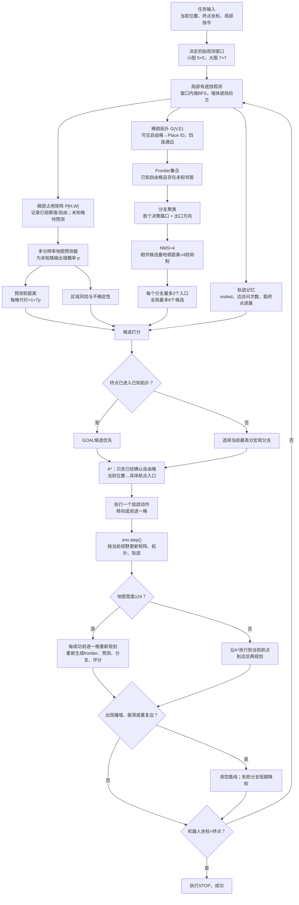
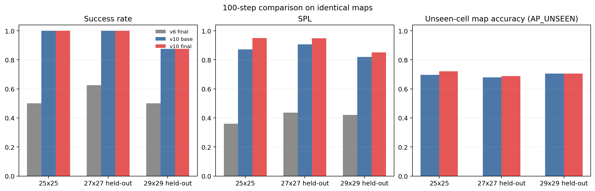
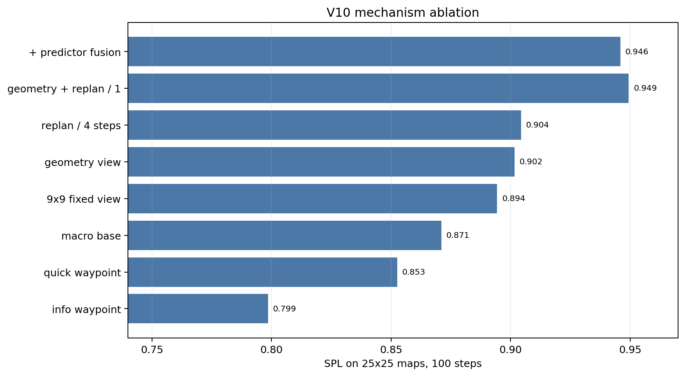

# MapGPT v10：精简实验报告

- 日期：2026-11-23
- 实验：21×21、25×25、27×27、29×29 四套地图，每组 8 张
- 目标：同时提高成功率 SR、路径效率 SPL 和未观察区域预测精度 AP

## 1. 结论

最终方法为：

**宏观分支 + 多分辨率地图预测 + 几何自适应 7×7/9×9 观测 + 大图逐步滚动重规划 + 结构化历史评分。**

100 步下，三套大型地图平均：

- 相对同预测器的保守基线：SPL **+4.3 个点**，AP **+0.7 个点**，联合分 **+2.3 个点**；
- 相对旧 v6：成功率平均提高约 **42 个点**，SPL 平均提高约 **51 个点**；
- 25×25 和27×27上 AP、SPL 同时提高；
- 29×29上 SPL 提高，AP 持平，因此不能声称所有地图都能同时提升两项指标。

最终保留：

- 宏观分支；
- NMS=4；
- 多分辨率预测器；
- 大图逐步重规划；
- 几何自适应观测；
- 结构化分支与轨迹历史；
- 坐标 STOP 和重复边/振荡保护。

最终删除：

- Qwen 主控；
- 地图熵直接奖励；
- 持续回程预算惩罚；
- 后悔回撤；
- 信息型、最深、最近代表航点；
- 固定预算门控；
- 双预测器融合作为默认配置；
- 固定每4步重规划。

## 2. 完整流程

### 观测窗口规则

- 机器人只看到以自身为中心、受墙体遮挡的局部窗口；
- 大图默认7×7；
- 已知拓扑度数≥3，即岔路口，使用9×9；
- 局部可通过性代理 `max(左右自由数, 上下自由数)+1≥3`，使用9×9；
- 上述“开放区”只是局部几何启发式，不是语义房间识别；
- 最终实验使用5×5、7×7、9×9，不使用8×8。

## 3. 指标与公平性

- SR：预算内到达终点并执行 STOP；
- SPL：`最短路径 / max(实际路径, 最短路径)`，失败记0；
- AP_UNSEEN：对每个决策点，将未知格的预测墙体与隐藏真值比较，计算二元占用正确率；episode内平均；
- JOINT：`sqrt(SPL × AP_UNSEEN)`；
- 真实完整地图和最短路径只用于仿真碰撞与离线评分，不进入航点决策；
- 每条实验条件使用完全相同的8张地图和相同预算。

说明：AP_UNSEEN 是本项目指标，不等同于目标检测中的 Average Precision。

## 4. 主要结果

### 4.1 100步主结果

| 地图 | 方法 | SR | SPL | AP_UNSEEN |
|---|---|---:|---:|---:|
| 21×21 | v6 final | **1.000** | 0.709 | 0.649 |
| 21×21 | v10 final | **1.000** | **0.982** | **0.652** |
| 25×25 | v6 final | 0.500 | 0.360 | 0.689 |
| 25×25 | 保守宏观基线9×9 | **1.000** | 0.894 | 0.709 |
| 25×25 | v10 final | **1.000** | **0.949** | **0.720** |
| 27×27 | v6 final | 0.625 | 0.436 | 不记录 |
| 27×27 | 保守宏观基线9×9 | **1.000** | 0.906 | 0.679 |
| 27×27 | v10 final | **1.000** | **0.948** | **0.688** |
| 29×29 | v6 final | 0.500 | 0.420 | 不记录 |
| 29×29 | 保守宏观基线9×9 | 0.875 | 0.820 | **0.705** |
| 29×29 | v10 final | 0.875 | **0.852** | 0.705 |

分析：

1. 21×21已经接近饱和，最终方法与v9最优结果相同；
2. 25×25上，最终方法把SPL提高5.5点、AP提高1.1点，成功率不降；
3. 27×27复现了SPL与AP共同提升；
4. 29×29主要提升路径效率，AP没有继续提高；
5. 旧v6的主要问题是长分支探索过多，宏观分支和滚动重规划直接解决了这一部分。

### 4.2 预算敏感性

80步重点是验证相对旧v6的改进：

| 地图，80步 | v6 SR/SPL | v10 final SR/SPL |
|---|---:|---:|
| 21×21 | 0.750 / 0.531 | **0.875 / 0.862** |
| 25×25 | 0.250 / 0.185 | **0.750 / 0.727** |
| 27×27 | 0.375 / 0.270 | **0.750 / 0.730** |
| 29×29 | 0.375 / 0.327 | **0.875 / 0.852** |

100/120步重点是验证同预测器保守基线与最终方法：

| 地图，预算 | 保守基线 SR/SPL | 最终 SR/SPL |
|---|---|---|
| 25×25，100 | 1.000 / 0.894 | 1.000 / **0.949** |
| 25×25，120 | 1.000 / 0.894 | 1.000 / **0.949** |
| 27×27，100 | 1.000 / 0.906 | 1.000 / **0.948** |
| 27×27，120 | 1.000 / 0.906 | 1.000 / **0.948** |
| 29×29，100 | 0.875 / 0.820 | 0.875 / **0.852** |
| 29×29，120 | 0.875 / 0.820 | 0.875 / **0.852** |

分析：

- 收益在80步紧预算下最大，说明方法主要减少无效探索；
- 100步后多数地图已到达终点，120步没有进一步收益；
- 29×29始终有1张traps地图失败，增加预算也没有解决，说明该失败不是单纯时间不足。

### 4.3 配对差异

| 地图，100步 | ΔSR | ΔSPL | SPL配对bootstrap 95%区间 | 逐图结果 |
|---|---:|---:|---|---|
| 25×25 | 0 | +0.078 | [0.018, 0.139] | 5胜2平1负 |
| 27×27 | 0 | +0.043 | [-0.003, 0.094] | 4胜3平1负 |
| 29×29 | 0 | +0.031 | [0.012, 0.051] | 5胜3平0负 |

每套地图只有8张，27×27的区间跨0，应视为方向性证据。

## 5. 全部消融实验分析

### 5.1 观测窗口与开放区策略

25×25，100步：

| 观测策略 | SR | SPL | AP | 结论 |
|---|---:|---:|---:|---|
| 固定5×5 | 1.000 | 0.775 | 0.683 | 视野不足 |
| 固定7×7 | 1.000 | 0.871 | 0.697 | 基础方案 |
| 固定9×9 | 1.000 | 0.894 | 0.709 | AP高，但计算与路径不是最优 |
| 分阶段放大 | 1.000 | 0.865 | 0.696 | 负收益 |
| 停滞时放大 | 1.000 | 0.871 | 0.697 | 中性 |
| **几何自适应7/9** | **1.000** | **0.902** | **0.707** | 保留 |
| 小图几何自适应 | 1.000 | 0.982 | 0.652 | 与固定5×5相同 |

分析：固定大视野能提高AP，但不保证SPL；按局部几何切换视野是更好的折中。

### 5.2 重规划频率

25×25，100步：

| 重规划间隔 | SR | SPL | AP |
|---|---:|---:|---:|
| 每1次前进 | **1.000** | **0.949** | **0.720** |
| 每2次前进 | 1.000 | 0.936 | 0.719 |
| 每3次前进 | 1.000 | 0.925 | 0.719 |
| 每4次前进 | 1.000 | 0.904 | 0.700 |
| 每6次前进 | 1.000 | 0.868 | 0.696 |
| 每8次前进 | 1.000 | 0.871 | 0.697 |
| 每12次前进 | 1.000 | 0.871 | 0.697 |

27×27上，每4步版本出现1次失败；每1步版本恢复SR=1.000，SPL=0.948。

分析：长分支中局部新观测会快速改变最优出口，旧路线继续执行的沉没成本很高。逐格重规划的代价是A*调用次数增加。

### 5.3 航点代表方式

25×25，100步：

| 航点选择 | SR | SPL | AP |
|---|---:|---:|---:|
| 默认分支入口 | **1.000** | **0.871** | 0.697 |
| 信息量最大格 | 1.000 | 0.799 | 0.698 |
| 路径最深格 | 0.875 | 0.648 | 0.696 |
| 最近入口 | 1.000 | 0.853 | 0.701 |

21×21也呈相同趋势：信息型0.917、最深型0.840、最近型0.848，均低于默认0.982。

分析：把航点推到更远或更高信息位置会增加错误分支的承诺成本；“具体入口格”最稳。

### 5.4 预测距离与模型融合

25×25，100步，固定7×7：

| 终点距离/预测器 | SR | SPL | AP |
|---|---:|---:|---:|
| 纯乐观已知图距离 | 1.000 | 0.859 | 0.694 |
| 预测/乐观各50% | 1.000 | 0.881 | 0.693 |
| 纯预测软距离 | **1.000** | **0.871** | **0.697** |
| 双预测器融合权重0.25 | 1.000 | 0.871 | 0.696 |
| 双预测器融合权重0.50 | 1.000 | 0.871 | **0.700** |
| 双预测器融合权重0.75 | 1.000 | 0.871 | 0.693 |

21×21上增加预测距离权重会把SR从1.000降到0.875，说明小图不应过度信任地图补全。

双预测器融合与逐步重规划组合后：

- 25×25：SPL从0.949降到0.946，AP从0.720升到0.724；
- 27×27：SPL从0.948降到0.930，AP从0.688升到0.691。

分析：融合能小幅提高AP，但不能稳定提高SPL，因此不作为默认。

### 5.5 宏观粒度与NMS

21×21，100步：

| 粒度 | SPL | 结论 |
|---|---:|---|
| NMS=2 | 0.965 | 候选重复 |
| **NMS=4** | **0.982** | 保留 |
| NMS=6 | 0.949 | 分支过少 |
| 每分支仅1候选 | 0.982 | 无额外影响 |
| Top-k=4 | 0.982 | 无额外影响 |

NMS=4表示：候选入口与已保留入口的曼哈顿距离小于4时被抑制，最终候选空间间隔至少4格。

### 5.6 预算门控与“锁定终点后扩视野”

| 方法 | 25×25 | 27×27 | 29×29 | 结论 |
|---|---:|---:|---:|---|
| 最终方法 | 0.949 / 0.720 | 0.948 / 0.688 | 0.852 / 0.705 | 稳定 |
| 预算门控，倍率2 | **0.953 / 0.722** | 0.945 / 0.687 | 0.835 / 0.710 | 只在小图有效 |
| 锁定终点后9×9 | 0.946 / 0.719 | 0.948 / 0.688 | 未提升 | 收益有限 |

分析：手工预算门控和终点后扩视野都只产生局部收益，不能跨地图复现。

### 5.7 地图预测器

固定快照测试：

| 预测器 | 21 AP | 21平衡准确率 | 25 AP | 25平衡准确率 |
|---|---:|---:|---:|---:|
| 原logistic | 0.611 | 0.711 | 0.667 | 0.708 |
| **多分辨率logistic** | **0.631** | **0.808** | **0.668** | **0.749** |
| 结构距离先验 | 0.619 | 0.668 | 0.555 | 0.642 |

分析：

- 多分辨率训练提高了平衡准确率，是默认预测器；
- AP提高不自动带来SPL提高；
- 最终方法各episode中AP–SPL相关约0.42–0.46，AP–覆盖率相关约0.81–0.90；
- AP更反映“补全了多少可解释结构”，轨迹进展才更直接反映卡死风险。

### 5.8 Qwen与强化学习

- qwen-plus地图解析率62.5%，qwen-max为58.3%；
- LLM预测AP未超过非LLM结构预测器；
- 宏观候选近平局时调用LLM，在普通宏观方法上只增加约0.6个SPL点，在统一成本方法中没有稳定收益；
- 最终几何任务不调用LLM；
- 本轮没有训练RL。原因是没有足够多的独立训练地图，直接在8张评测图上训练容易产生记忆和泄漏。

## 6. 防卡死与失败分析

最终方法在25×25、27×27的100/120步均为SR=1.000。29×29仍有一个固定失败地图。

| 场景 | 失败数 | 特征 | 原因 |
|---|---:|---|---|
| 25×25，80 | 2/8 | 撞墙0，终点距离3和5 | 预算耗尽前差最后几步 |
| 27×27，80 | 2/8 | 撞墙0，终点距离2和10 | 长分支探索占用过多 |
| 29×29，80 | 1/8 | 终点距离16 | 探索远端后未及回程 |
| 29×29，100/120 | 1/8 | 同一trap地图，距离17 | 分支选择问题，不是原地打转 |

最终保留的防卡死机制：

- 撞墙后清空当前路线；
- 连续5帧重复位置触发振荡检测；
- 同一无向边重复访问过多时重新规划；
- 分支无信息且无目标进展时短期禁用；
- 坐标严格等于终点时才STOP。

删除的机制：地图熵奖励、持续回程惩罚、后悔回撤和固定预算门控。它们或者不触发，或者只改变1–2步但没有稳定收益。

## 7. 最终方法与限制

最终方法：

1. 21×21使用5×5观测、宏观/微观统一成本，到达航点后重规划；
2. 25×25以上使用7×7/9×9自适应观测、只用宏观分支；
3. 25×25以上每成功前进一格重新评分；
4. 航点分数由已知A*路径、预测终点距离、风险、信息量、不确定性和结构化历史组成；
5. A*只规划已确认自由格，预测矩阵只提供软距离和风险；
6. 全程不使用LLM主控。

主要限制：

- 每组只有8张地图；
- 大图阈值“地图宽度≥24格”和重规划频率来自这组实验，仍需更多地图验证；
- 逐格重规划增加计算开销，本轮没有优化CPU时间；
- 开放区判定是局部几何代理，不是语义房间识别；
- 29×29已出现AP不再提升和固定trap失败案例。

## 8. 实验文件

- `figs/fig1_maps_v10.png`：27×27留出地图；
- `figs/fig2_main_comparison.png`：100步主结果；
- `figs/fig3_ablation.png`：模块消融；
- `figs/fig4_budget.png`：预算敏感性；
- `data/aggregate.csv`：全部实验条件；
- `data/aggregate.json`：总体与最终对比；
- `data/per_map_comparison.csv`：逐地图配对结果；
- `data/failure_cases.csv`：失败轨迹指标；
- `code/`：最终代码、地图、预测器和运行脚本。

设计参考：R2F的无LLM方向frontier、GroundControl的轨迹失败信号、MOON的历史清除、Racing the Clock的预算/房间抽象、OpenSpace的预测地图全局规划。本轮只保留能在同一地图上产生可复现收益的部分。
